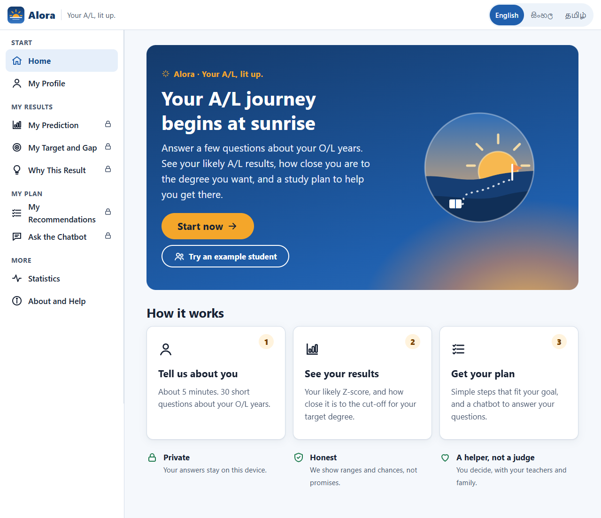

# Alora – Your A/L, lit up.

**Alora** ("A/L" + *aurora*, the light at dawn) is a decision-support web app for Sri Lankan students who have just finished their O/L and are starting the A/L Science stream. It has five parts:

- it estimates their likely A/L results;
- it compares them with the official university cut-offs for their district;
- it explains why it gives that result;
- it gives a study plan;
- it answers their questions through a chatbot.

It works offline on one laptop, in **English, Sinhala and Tamil**. It is a final-year thesis artifact and a **support tool, not a decision maker**.



## The five parts

| Part | Code | What it does | Endpoint |
|---|---|---|---|
| 1. Prediction | `src/models` | Neural networks only, no ensembles. The Z-score is shown as a range (8 in 10 inside). Band, degree area and university region come with a trust message from the test calibration. | `POST /api/predict` |
| 2. Recommendations | `src/recommend`, `configs/recommend.yaml` | 14 transparent rules, each with a reason and evidence, plus what similar students who reached the target reported doing. Two modes: *close the gap* / *stay on track*. | `POST /api/recommend` |
| 3. Target gap | `src/gap` | Predicted range against the official UGC cut-offs (2019/20, 2021/22, 2023/24) for the student's district. Universities are grouped *within reach / close / further away*. | `POST /api/gap` |
| 4. Chatbot | `src/chatbot` | Local model (Qwen 2.5 7B through Ollama), grounded only in the student's results. A safety guard, a number check and exact university lookups. Always shows the support-tool notice. | `POST /api/chat` |
| 5. Explainable AI | `src/explain` | SHAP explanations, grouped into 5 question groups, checked for additivity and stability. | `POST /api/explain` |

The web interface is in `frontend/`: plain HTML, CSS and JavaScript, served by the same backend at `/`.

## Quick start (Windows, PowerShell)

**Needs:** Python 3.12. The chatbot also needs [Ollama](https://ollama.com). The optional checks need Node.js and Google Chrome.

```powershell
cd C:\AL_outcome_predictor
py -3.12 -m venv .venv
.\.venv\Scripts\Activate.ps1
python -m pip install -r requirements.txt --extra-index-url https://download.pytorch.org/whl/cpu
ollama pull qwen2.5:7b ; ollama pull llama3.2:3b      # chatbot models (free, run locally)

uvicorn backend.app:app --port 8000
```

**Open <http://localhost:8000>.**
- Try a made-up student with `http://localhost:8000/?demo=average` (also `strong`, `weak`).
- The API documentation is at `/docs`.
- Without Ollama everything still works, except that the chatbot replies that it is not available.

If PowerShell refuses to run `Activate.ps1`, run `Set-ExecutionPolicy -Scope CurrentUser -ExecutionPolicy RemoteSigned` once.

## Checks

```powershell
python -m pytest                      # unit, integration and end-to-end tests (fake chatbot model)
python -m ruff check .                # lint
python -m src.data.register_raw --verify   # the raw data files are unchanged

cd frontend
npm install                           # once: puppeteer-core (uses the installed Chrome)
npm run check:i18n                    # every Sinhala/Tamil text key matches English
npm run e2e                           # a "student" clicks through the real website (backend running)
npm run screenshots                   # screenshots for docs\phase10_screenshots
```

## Notebooks (thesis appendix)

`notebooks/01`–`06` show the whole pipeline with real outputs:
- data preparation and the locked split;
- feature engineering;
- **model training**: the chosen networks are re-trained live and match the logged Phase 6 scores exactly;
- the single Phase 7 test-set evaluation, read from its saved results (the test set is not re-opened);
- explainable AI;
- the five parts end to end.

They call the code in `src/` and print totals and averages only, never a respondent's answers.

```powershell
python notebooks/build_notebooks.py               # write, run all six, export HTML + PDF to notebooks/exports
python notebooks/build_notebooks.py --export-only # only re-export HTML + PDF
```

## How it was built: phases and documents

Each phase has its own document in [docs/](docs/):

| Phase | Document | Main commands |
|---|---|---|
| 0 Setup, data registration | `phase00_project_setup.md` | `python -m src.data.register_raw --verify` |
| 1 Questionnaire validation | `phase01_questionnaire_validation.md` | `python -m src.data.run_phase01` |
| 2 Hypotheses and success criteria (locked) | `phase02_hypotheses_and_success_criteria.md` | `configs/success_criteria.lock.json` |
| 3 Cleaning and labels | `phase03_data_labeling_and_documentation.md` | `python -m src.data.run_phase03` |
| 4 Features (fitted on training data only) | `phase04_feature_engineering.md` | `python -m src.data.split`, `python -m src.features.run_phase04` |
| 5 Split and class balance | `phase05_data_splitting.md` | `python -m src.data.run_phase05` |
| 6 Training and tuning (8 neural networks) | `phase06_train_and_tune.md` | `python -m src.models.run_phase06 --step all`, `run_phase06_final --part all`, `run_phase06 --step stage2` |
| 7 Test set, opened once | `phase07_test_and_evaluate.md` | `python -m src.evaluation.run_phase07` (refuses a second time), `--analyse` |
| 8 Interpretation | `phase08_interpretation.md` | `python -m src.explain.run_phase08` |
| 9 The five parts | `phase09_build_the_five_parts.md` | `python -m src.evaluation.run_phase09 <step>`; the steps are listed in the script |
| 10 Interface | `phase10_user_interface.md` | `uvicorn backend.app:app --port 8000` |
| 11 Integration and user test | `user_testing/` (session plan, consent, tasks, questionnaire, expert review) | `python -m src.evaluation.user_test` |

## Folder structure

```
backend/           FastAPI app: one endpoint per part, serves the interface
frontend/          Alora interface (HTML/CSS/JS, i18n/ en si ta, tools/ for checks and screenshots)
src/               data, features, models, evaluation, explain, gap, recommend, chatbot, system.py
configs/           every setting, threshold and rule (YAML); success criteria are locked
data/raw/          original files, read-only, checksummed (never committed to Git)
data/interim/, data/processed/   outputs of the scripts (never committed)
models/            trained networks and the feature pipeline
reports/           results per phase (tables, JSON, figures)
docs/              phase documents, screenshots, user-test materials
tests/             pytest: unit, integration and end-to-end tests
```

## Rules the project follows

- **Raw data is never edited.** Every change is a logged script. The raw files are read-only and checksummed.
- **All settings live in `configs/`**, with one random seed. The success criteria were **locked before training** (Phase 2).
- **Everything learned from data uses training rows only.** The test set was **opened once** (Phase 7). Later test-set use is limited to checks fixed in Phase 2, recorded in `reports/phase09/test_access.json`.
- **All models are reported, including worse ones.** No result is tuned on the test set.
- **No official figure is typed in by hand.** Cut-offs are read from the UGC documents supplied by the researcher.
- **Privacy:**
  - student answers stay in the browser;
  - the server stores nothing;
  - statistics show groups of 10 or more only;
  - survey data is never committed.

## Limitations

These are documented in the phase documents.

- **Who the model learned from.** It learned from students who entered a state university, so it knows less about lower results. The survey answers were given from memory.
- **University region.** The model predicts it no better than chance. Universities are therefore shown from the cut-off tables, as a guide, not as a prediction.
- **Degree-area chances** are only roughly calibrated.
- **Chatbot test.** The chatbot met 3 of its 4 automated targets (H11): it said "not sure" in 88 % of cases where 90 % was the target. The model is small and can mix up numbers, so named-university questions are answered by an exact lookup.
- **Translations.** The Sinhala and Tamil texts are first drafts waiting for checks.
- **User test.** Five testers and one expert give descriptive results only.
