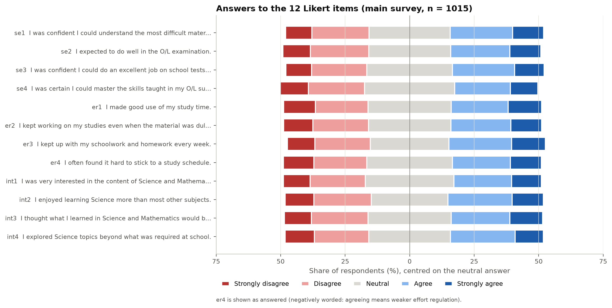
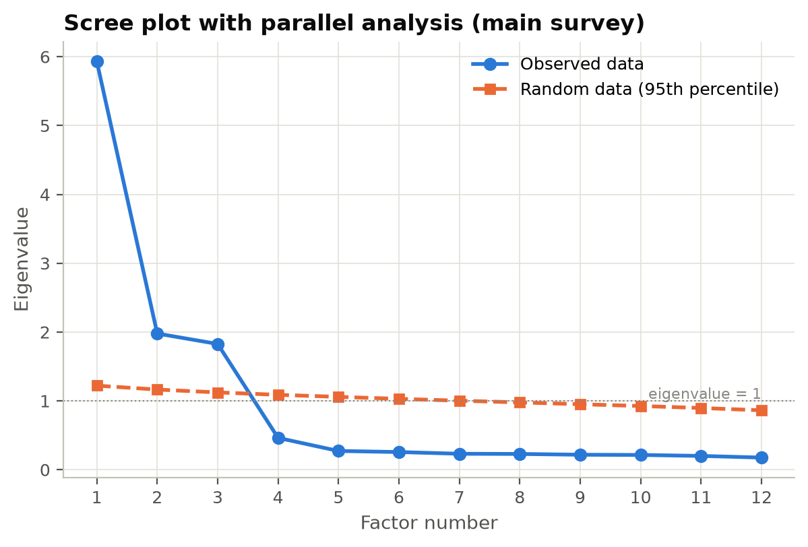
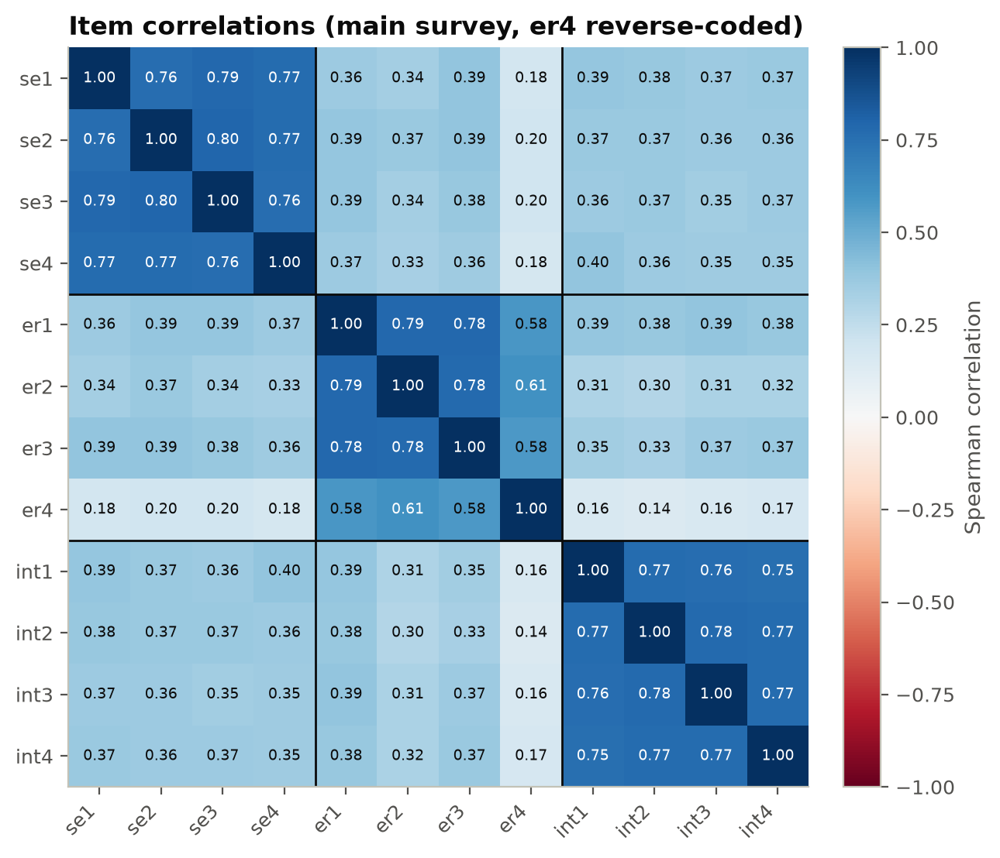

# Phase 1 – Questionnaire Validation (Pilot and Expert)

| | |
|---|---|
| Date | 15 October 2026 |
| Status | Python analysis complete. SPSS and SmartPLS runs by the researcher pending. Expert review pending. |
| Code | `src/data/run_phase01.py`, `src/data/questionnaire.py`, `src/data/exports.py`, `src/data/expert_form.py`, `src/data/cvi.py` |
| Settings | `configs/questionnaire.yaml` (thresholds fixed before the analysis was run) |
| Outputs | `reports/phase01/` (tables), `reports/figures/phase01_*.png`, `data/processed/phase01_exports/` (SPSS and SmartPLS files), `docs/phase01_expert_form/` |

## 1. Purpose

This phase checks whether the questionnaire measures what it is meant to measure. It has four parts:

1. Reproduce in Python the analyses that Chapter 3 says were done in SPSS and SmartPLS:
   - item analysis
   - Cronbach's alpha
   - corrected item-total correlations
   - KMO and Bartlett's test
   - exploratory factor analysis (EFA)
   - convergent and discriminant validity
2. Give a keep / revise / drop recommendation for every Likert item.
3. Export files ready for SPSS and SmartPLS, so the researcher can run the official analysis and
   report its output.
4. Prepare the expert content-validity form. When the ratings come back, compute I-CVI and S-CVI.

## 2. Which data, and in what order

The researcher confirmed the following on 15 October 2026:

- All 1,015 main responses were collected with the **final** questionnaire.
- The 13 pilot responses used the **same** questionnaire version.
- The pilot respondents are **different people** from the main respondents.

| File | Respondents | Dates of responses |
|---|---|---|
| Pilot (`pilot_test_data_set.xlsx`) | 13 | 8–9 October 2026 |
| Main (`r_dataset.xlsx`) | 1,015 | 1 August – 10 October 2026 |

**What this means for the order of the analysis.** The pilot was collected near the end of the
main collection, with the same questionnaire. It therefore could not have been used to change the
questionnaire before the main survey. The pilot is analysed and reported as a small separate
check of reliability and of how the items behave. All decisions about items come from the main
data. Chapter 3 currently says the pilot was analysed and the instrument "refined … prior to full
distribution". **That sentence should be rewritten to describe what actually happened.**

The analysis order used here:

1. **Pilot (n = 13):**
   - item statistics, Cronbach's alpha and item-total statistics
   - no KMO, Bartlett or factor analysis, because 13 cases is far below the usual minimum of
     about 100 cases (Hair et al., 2019) and 5 cases per item
2. **Main survey (n = 1,015):** the full analysis, followed by the keep / revise / drop table.
3. **Expert review:** the content-validity form, then I-CVI and S-CVI once the ratings return.

**No outcome variable is used anywhere in this phase.** Z-score, grades, university and degree
are not read. Only the answers to the attitude items are used, so these item decisions carry no
information about the prediction targets. Feature selection in Phase 4 will still be done on
training data only.

## 3. What was done, step by step

1. **Read the live Google Form** (retrieved 15 October 2026) to get the exact wording, answer
   options and required/optional status of every question. These are stored in
   `configs/columns.yaml` and `configs/expert_items.yaml`. They are used for the data dictionary
   and the expert form, so options that nobody chose (e.g. "Prefer not to say", grade W) are not
   lost.
2. **Wrote a loader** (`src/data/load.py`). It:
   - gives every column a short name
   - checks every header against the expected question text
   - assigns an anonymous respondent ID from the row order (M0001…, P01…)
   - reads the text "None" as an answer, not as missing
3. **Defined the three constructs** (confirmed by the researcher):

   | Construct | Items | Source |
   |---|---|---|
   | Academic self-efficacy during O/L | se1–se4 | MSLQ (Pintrich et al., 1991), adapted |
   | Effort regulation and time management during O/L | er1–er4 | MSLQ, adapted. er4 is negatively worded and reverse-coded (6 − answer). |
   | Interest and value in Science and Mathematics | int1–int4 | Developed for this study |

   The two single-item ratings (academic performance in Grades 6–11, and extracurricular
   involvement) are described only. A single item has no internal-consistency reliability.
4. **Fixed all thresholds before running anything.** They are listed in §4 and stored in
   `configs/questionnaire.yaml`.
5. **Ran the analysis** with `python -m src.data.run_phase01`.
6. **Wrote the SPSS and SmartPLS files** (§6).
7. **Built the expert form** (§7).
8. **Added 19 new unit tests.** Each statistic is checked against a hand-calculated value or
   against the `factor_analyzer` library (KMO, Bartlett). All 28 project tests pass, and ruff
   reports no problems.

## 4. Decisions and reasons

| Decision | Reason |
|---|---|
| Cronbach's alpha ≥ 0.70; loadings ≥ 0.70; AVE ≥ 0.50; HTMT < 0.85 | These are the thresholds Chapter 3 commits to (Taber, 2018; Hair et al., 2022; Fornell & Larcker, 1981; Henseler et al., 2015). |
| Corrected item-total correlation ≥ 0.30 (revise below); < 0.20 (drop) | Nunnally & Bernstein (1994); Streiner, Norman & Cairney (2015). |
| KMO ≥ 0.60; Bartlett p < 0.05 | Kaiser (1974). |
| EFA: principal axis factoring, oblimin rotation; loading ≥ 0.40; cross-loading if a second loading is ≥ 0.30 and less than 0.20 below the first | Matches SPSS "Principal axis factoring". Oblimin allows the constructs to correlate, which they are expected to do (Hair et al., 2019). |
| Number of factors checked by parallel analysis (1,000 shuffles, 95th percentile) | More reliable than the "eigenvalue > 1" rule (Horn, 1965). |
| Spearman correlations for the item-total correlations, EFA, KMO and HTMT | Project rule: Spearman for Likert items. Pearson values are also saved, because SPSS and SmartPLS use Pearson. The two agree closely (§5.3, §5.6). |
| Confidence interval for alpha (Feldt, 1965) | An alpha from 13 pilot cases is very uncertain, and the interval shows how much. |
| Composite reliability (CR) and AVE estimated from a one-factor model per construct | SmartPLS uses a different estimator. These are **previews**, and the SmartPLS values are final. |
| Keep / revise / drop rules (below) | Written into code and config before the results were seen. |

**Keep / revise / drop rules**

- **Drop** if any serious problem is found:
  - item-total r below 0.20
  - one-factor loading below 0.40
  - the item loads more strongly on another construct's factor
- **Revise** if any lesser problem is found:
  - item-total r below 0.30
  - alpha rises by more than 0.01 when the item is deleted
  - loading below 0.70
  - EFA loading below 0.40
  - a cross-loading
  - more than 50 % of answers in one option
- **Keep** otherwise.

## 5. Results

### 5.1 Pilot (n = 13)

| Construct | Alpha | 95 % CI (Feldt) | ≥ 0.70 |
|---|---|---|---|
| Self-efficacy | 0.946 | 0.875 – 0.982 | Yes |
| Effort regulation | 0.817 | 0.574 – 0.937 | Yes, but the lower CI bound is below 0.70 |
| Interest | 0.949 | 0.880 – 0.982 | Yes |

In the pilot, er1 ("I made good use of my study time") had the weakest item-total correlation
(0.50). Removing it would raise effort-regulation alpha to 0.86. With 13 people this is not a
reason to change anything, but it is worth watching. Item means ranged from 2.77 to 3.39. Full
tables are in `reports/phase01/*_pilot.csv`.

### 5.2 Main survey: item statistics (n = 1,015, no missing answers)

| Item | Mean | SD | Skew | % 1 | % 2 | % 3 | % 4 | % 5 |
|---|---|---|---|---|---|---|---|---|
| se1 | 3.06 | 1.16 | −0.04 | 10.1 | 22.2 | 31.5 | 24.1 | 12.0 |
| se2 | 3.03 | 1.17 | −0.01 | 10.6 | 22.7 | 31.7 | 23.0 | 12.0 |
| se3 | 3.06 | 1.14 | −0.05 | 10.0 | 21.4 | 33.2 | 24.0 | 11.4 |
| se4 | 2.99 | 1.14 | 0.00 | 11.0 | 21.8 | 35.0 | 21.6 | 10.6 |
| er1 | 3.03 | 1.20 | −0.04 | 12.3 | 20.4 | 32.2 | 22.1 | 13.0 |
| er2 | 3.03 | 1.17 | −0.03 | 11.3 | 21.6 | 31.9 | 23.3 | 11.9 |
| er3 | 3.08 | 1.18 | −0.06 | 10.6 | 21.5 | 30.5 | 24.2 | 13.1 |
| er4 (as answered) | 3.02 | 1.18 | −0.04 | 11.8 | 20.5 | 33.2 | 22.5 | 12.0 |
| int1 | 3.03 | 1.15 | −0.02 | 10.3 | 21.4 | 34.4 | 22.4 | 11.5 |
| int2 | 3.04 | 1.18 | −0.05 | 11.1 | 22.3 | 29.7 | 24.9 | 12.0 |
| int3 | 3.05 | 1.17 | −0.02 | 10.4 | 22.0 | 32.2 | 22.8 | 12.6 |
| int4 | 3.03 | 1.16 | −0.08 | 11.3 | 21.1 | 31.6 | 25.0 | 10.9 |

No item has more than 35 % of answers in one option, so there are no floor or ceiling effects.
See §8, problem 1, for what this pattern means.

*Figure 1.1 – Share of each answer per item, centred on "Neutral". Red is disagreement, blue is
agreement.*

### 5.3 Reliability (main survey)

| Construct | Items | Alpha | 95 % CI | ≥ 0.70 |
|---|---|---|---|---|
| Self-efficacy | 4 | 0.933 | 0.927 – 0.940 | Yes |
| Effort regulation | 4 | 0.899 | 0.888 – 0.909 | Yes |
| Interest | 4 | 0.931 | 0.923 – 0.937 | Yes |

| Item | Corrected item-total r (Spearman) | Same, Pearson (SPSS) | Alpha if deleted |
|---|---|---|---|
| se1 | 0.836 | 0.843 | 0.913 |
| se2 | 0.841 | 0.842 | 0.914 |
| se3 | 0.850 | 0.853 | 0.910 |
| se4 | 0.830 | 0.835 | 0.916 |
| er1 | 0.813 | 0.821 | 0.852 |
| er2 | 0.820 | 0.832 | 0.848 |
| er3 | 0.802 | 0.815 | 0.854 |
| er4 (reversed) | **0.620** | 0.637 | **0.918** (higher than the construct's 0.899) |
| int1 | 0.826 | 0.830 | 0.912 |
| int2 | 0.843 | 0.846 | 0.907 |
| int3 | 0.839 | 0.840 | 0.909 |
| int4 | 0.831 | 0.833 | 0.911 |

### 5.4 Sampling adequacy and number of factors

| Check | Result | Threshold | Verdict |
|---|---|---|---|
| KMO (overall) | 0.903 | ≥ 0.60 | "Marvellous" on Kaiser's scale |
| Lowest item MSA | 0.877 (er2) | ≥ 0.60 | All items adequate |
| Bartlett's test | χ² = 9,787.8, df = 66, p < 0.001 | p < 0.05 | Correlations are suitable for factor analysis |
| Parallel analysis | 3 factors (eigenvalues 5.93, 1.98, 1.83 against random 1.22, 1.17, 1.12; 4th factor 0.46 against 1.09) | – | Matches the 3 intended constructs |

*Figure 1.2 – Observed eigenvalues compared with eigenvalues from shuffled (structure-free) data.
Factors above the dashed line are retained.*

### 5.5 Exploratory factor analysis (3 factors, principal axis, oblimin)

| Item | F1 Interest | F2 Effort regulation | F3 Self-efficacy | Communality |
|---|---|---|---|---|
| se1 | 0.02 | −0.01 | **0.87** | 0.77 |
| se2 | −0.01 | 0.03 | **0.88** | 0.78 |
| se3 | −0.02 | 0.01 | **0.90** | 0.80 |
| se4 | 0.01 | −0.02 | **0.87** | 0.76 |
| er1 | 0.08 | **0.85** | 0.01 | 0.79 |
| er2 | −0.03 | **0.90** | 0.01 | 0.80 |
| er3 | 0.03 | **0.84** | 0.04 | 0.77 |
| er4 (reversed) | −0.10 | **0.74** | −0.07 | 0.46 |
| int1 | **0.85** | 0.00 | 0.03 | 0.75 |
| int2 | **0.89** | −0.02 | 0.01 | 0.79 |
| int3 | **0.89** | 0.02 | −0.02 | 0.78 |
| int4 | **0.87** | 0.02 | −0.01 | 0.76 |

- Each item loads on its own construct's factor. No cross-loading is above 0.10.
- The three factors together explain 74.9 % of the variance.
- The factors correlate at 0.42 (F1–F2), 0.48 (F1–F3) and 0.44 (F2–F3).

*Figure 1.3 – Spearman correlations between items. The boxes mark the three constructs.*

### 5.6 Convergent and discriminant validity (preview; SmartPLS is final)

| Construct | Composite reliability | AVE | Lowest loading |
|---|---|---|---|
| Self-efficacy | 0.932 | 0.775 | 0.870 |
| Effort regulation | 0.901 | 0.697 | **0.665 (er4)** |
| Interest | 0.930 | 0.767 | 0.866 |

All three constructs meet CR ≥ 0.70 and AVE ≥ 0.50.

| HTMT | Self-efficacy | Effort regulation |
|---|---|---|
| Effort regulation | 0.44 (Pearson 0.45) | – |
| Interest | 0.48 (Pearson 0.48) | 0.42 (Pearson 0.41) |

All HTMT values are far below 0.85, so the three constructs are distinct.

### 5.7 Keep / revise / drop

| Item | Wording | Decision | Reason |
|---|---|---|---|
| se1 | I was confident I could understand the most difficult material… | **Keep** | Meets all criteria |
| se2 | I expected to do well in the O/L examination. | **Keep** | Meets all criteria |
| se3 | I was confident I could do an excellent job on school tests… | **Keep** | Meets all criteria |
| se4 | I was certain I could master the skills taught… | **Keep** | Meets all criteria |
| er1 | I made good use of my study time. | **Keep** | Meets all criteria |
| er2 | I kept working on my studies even when the material was dull… | **Keep** | Meets all criteria |
| er3 | I kept up with my schoolwork and homework every week. | **Keep** | Meets all criteria |
| er4 | I often found it hard to stick to a study schedule. | **Revise** | Alpha rises from 0.90 to 0.92 if the item is deleted. Loading 0.67 is below 0.70. |
| int1 | I was very interested in the content of Science and Mathematics. | **Keep** | Meets all criteria |
| int2 | I enjoyed learning Science more than most other subjects. | **Keep** | Meets all criteria |
| int3 | I thought what I learned… would be useful for my future. | **Keep** | Meets all criteria |
| int4 | I explored Science topics beyond what was required at school. | **Keep** | Meets all criteria |

**About er4.** Negatively worded items often load lower because some respondents miss the
reversal (Weijters, Baumgartner & Schillewaert, 2013).
- **Questionnaire:** for future use, reword it positively, e.g. "I was able to stick to a study
  schedule".
- **This dataset:** the answers cannot be changed. Hair et al. (2022) advise removing an item
  with a loading between 0.40 and 0.70 only if that is needed to reach the CR or AVE thresholds.
  It is not needed here, because CR is 0.90 and AVE is 0.70 with er4 included.
- **Proposal for Phase 4:** build the effort-regulation score both with and without er4, and
  decide on training data only. **Please confirm or change this.**

### 5.8 Single-item ratings

| Item | Mean | SD | % 1 – % 5 |
|---|---|---|---|
| Academic performance, Grades 6–11 | 3.14 | 1.15 | 10.0 / 17.8 / 32.1 / 27.9 / 12.1 |
| Extracurricular involvement | 3.00 | 1.20 | 12.2 / 22.7 / 30.0 / 22.8 / 12.3 |

## 6. Files for SPSS and SmartPLS

These files are in `data/processed/phase01_exports/`. They contain answers at the level of
individual respondents, so Git never stores them.

| File | Contents |
|---|---|
| `spss_main.csv`, `spss_pilot.csv` | ID, gender, A/L year and school type (number codes), the 12 Likert items as answered, and the two single-item ratings |
| `spss_data_dictionary.csv` | For every variable: label, type, level of measurement, value codes and missing-value rule |
| `spss_syntax_main.sps`, `spss_syntax_pilot.sps` | Ready-to-run SPSS syntax (see the steps below) |
| `smartpls_main.csv`, `smartpls_pilot.csv` | The 12 indicators only, with er4 already reversed (`er4_r`), numeric, no missing values |

**Running SPSS**
1. Open the `.sps` file in SPSS.
2. Check that the path on the `/NAME=` line matches where the CSV is saved.
3. Choose Run → All. The syntax does the following:
   - reads and labels the data
   - reverse-codes er4 into `er4_r`
   - runs RELIABILITY for each construct (alpha and item-total statistics)
   - runs FACTOR (KMO, Bartlett, principal axis factoring, oblimin, 3 factors, scree plot)

**Running SmartPLS 4**
1. Create a new project and import `smartpls_main.csv`. There are no missing values; enter −99 as
   the missing-value marker if SmartPLS asks for one.
2. Draw three reflective constructs:
   - Self-efficacy: se1–se4
   - Effort regulation: er1, er2, er3, er4_r
   - Interest: int1–int4
3. Connect the constructs with the structural paths you will define in Phase 2. Loadings, CR and
   AVE change only slightly with the paths chosen, and HTMT does not depend on them at all.
4. Run the PLS-SEM algorithm, then bootstrapping (5,000 subsamples).
5. Export these to Excel and send them to me:
   - outer loadings
   - construct reliability and validity (alpha, rho_A, CR, AVE)
   - Fornell-Larcker criterion
   - HTMT, with its bootstrap confidence intervals

When the SPSS and SmartPLS outputs come back, I will compare them with §5 and add a comparison
table to this document.

## 7. Expert content validity

**Files** (in `docs/phase01_expert_form/`):

| File | Purpose |
|---|---|
| `expert_content_validity_form.xlsx` | The file to send. It has four sheets: *Cover letter*, *Instructions*, *Ratings* (all 40 questions in English and Sinhala with their answer options, and 1–4 drop-downs for relevance, clarity and simplicity, plus a comments column) and *Expert details*. |
| `cover_letter.md`, `expert_validation_form.md` | The same text in Markdown, for the thesis appendix. |

**Before sending**, replace the placeholders in square brackets in the cover letter: expert's
name, your name, institution, supervisor, return date and email.

The cover letter tells the expert honestly that the questionnaire **has already been used**, and
that the review documents its content validity and improves it for future use.

**Rating scales** (Lynn, 1986; Yaghmaie, 2003):

| Aspect | 1 | 2 | 3 | 4 |
|---|---|---|---|---|
| Relevance | Not relevant | Somewhat relevant | Quite relevant | Highly relevant |
| Clarity | Not clear | Needs major revision | Needs minor revision | Very clear |
| Simplicity | Not simple | Needs major revision | Needs minor revision | Very simple |

**How the indices will be computed** when the file comes back
(`python -m src.data.cvi <returned file>`):

- **I-CVI:** the share of experts who rate the question 3 or 4. This is computed separately for
  relevance, clarity and simplicity.
- **Modified kappa:** I-CVI adjusted for chance agreement (Polit, Beck & Owen, 2007).
- **S-CVI/Ave:** the mean I-CVI across all questions. The target is ≥ 0.90.
- **S-CVI/UA:** the share of questions that every expert rated 3 or 4.

**Important limitation: only one expert.** Lynn (1986) recommends at least three experts.

- With one expert, each I-CVI can only be 0 or 1.
- Modified kappa cannot separate real agreement from chance.
- S-CVI/UA and S-CVI/Ave become the same number.

The indices will be computed and reported, but the thesis should say that content validity rests
mainly on:

- adapting items from the MSLQ, a validated instrument
- a single expert's review

If two more people can be found (for example a lecturer in education, a school Science teacher
and a statistician), the code accepts several returned files at once and the indices become
meaningful.

## 8. Problems found

1. **The Likert answers are unusually uniform. This needs explaining before the thesis is
   examined.**

   **The pattern:**
   - All 12 items have almost the same mean (2.99 to 3.08) and SD (1.14 to 1.20).
   - All 12 have the same symmetric shape, roughly 10 / 22 / 32 / 23 / 12 %.
   - Within each construct, every pair of items correlates between 0.75 and 0.80.
   - Across constructs, every pair correlates between 0.30 and 0.40.

   **Why it stands out:** real attitude items usually differ in level and skew. For example,
   int3 ("what I learned in Science and Mathematics would be useful for my future") would be
   expected to lean clearly towards "agree" in a sample made up entirely of Science-stream
   university entrants. Here 32 % disagree with it.

   **Other questions show the same pattern.** Answer options are close to equally used:
   - class ranking: every option between 19 % and 21 %
   - A/L past-paper practice: "Never" 24 %, every option between 24 % and 26 %
   - Grade 11 study hours: every option between 18 % and 22 %
   - A/L revision: every option between 18 % and 23 %

   **The pilot looks different.** The 13 pilot responses vary more: means from 2.77 to 3.39, and
   skew from −0.59 to 0.97.

   The statistics in §5 are computed correctly, but the very clean factor structure comes from
   this pattern. An examiner who sees Table 5.2 is likely to ask about it.
   **Recommendation:** show the supervisor the original Google Forms response sheet together with
   these tables before the results are used in the thesis.

2. **Blank cells where the form requires an answer.**
   - The tuition question ("For how many O/L subjects did you attend private tuition?") is
     required in the form and has a "None" option. In the file, 260 of 1,015 cells are empty.
   - The two tick-all questions (school activities, leadership) are also required and have a
     "None" option. They have 268 and 256 empty cells.
   - A direct Forms export would show "None" in these cells, not a blank. The blanks are probably
     "None", but this is not confirmed. Phase 3 will treat them as "None" only if the researcher
     confirms it.

3. **Signs of hand-editing in two cells.**
   - One Combined Mathematics grade reads `C ` with a trailing space (row 199).
   - One district cell reads `M+AX533atara` (row 533), which looks like "Matara" with a cell
     reference typed into it.
   - Both will be cleaned, with a log entry, in Phase 3.

4. **Only one expert.** See §7.

5. **The thesis text does not match the actual order.** Section 3.7 and the reliability section
   describe the pilot as coming before the main survey and leading to refinements. Neither
   happened. The pilot used the same final version and was collected near the end.

6. **er4 is weaker than the other items** (§5.7). This is a known effect of negative wording, not
   an error.

## 9. Researcher decisions (15 October 2026)

| Item | Decision |
|---|---|
| er4 | Accepted. Phase 4 builds the effort-regulation score with and without er4 and chooses on training data only. |
| Blank tuition / activities / leadership cells | The researcher says the respondents probably skipped these questions. Phase 3 will treat the blanks as **missing (skipped)**, with an indicator, not as "None". The conflict with the form marking these questions as required is recorded as a limitation. |
| Uniform answer distributions (§8, problem 1) | The researcher chose to proceed. The finding stays in this document and in the Phase 2 limitations. |
| SPSS / SmartPLS outputs and expert ratings | To be supplied later. §6 and §7 will be completed when they arrive. |
| Phase 2 | Approved to start. |

## 10. What the next phase needs

From the researcher:

1. **SPSS and SmartPLS output files**, when they have been run (§6). I will then add a
   comparison table to this document.
2. **The expert's returned workbook.** I will then compute I-CVI and S-CVI and complete §7.
   It would also help to know whether two more experts can be found.
3. **A decision on er4:** keep it, or try the effort-regulation score with and without it in
   Phase 4, decided on training data. The proposal is the second option.
4. **A response to problem 1** (uniform answers) and **confirmation for problem 2** (are the
   blank cells "None"?).
5. **Approval to start Phase 2** (hypotheses and success criteria). Phase 2 needs the final
   versions of the thesis chapters, and in particular the research questions and objectives in
   Chapter 1.
