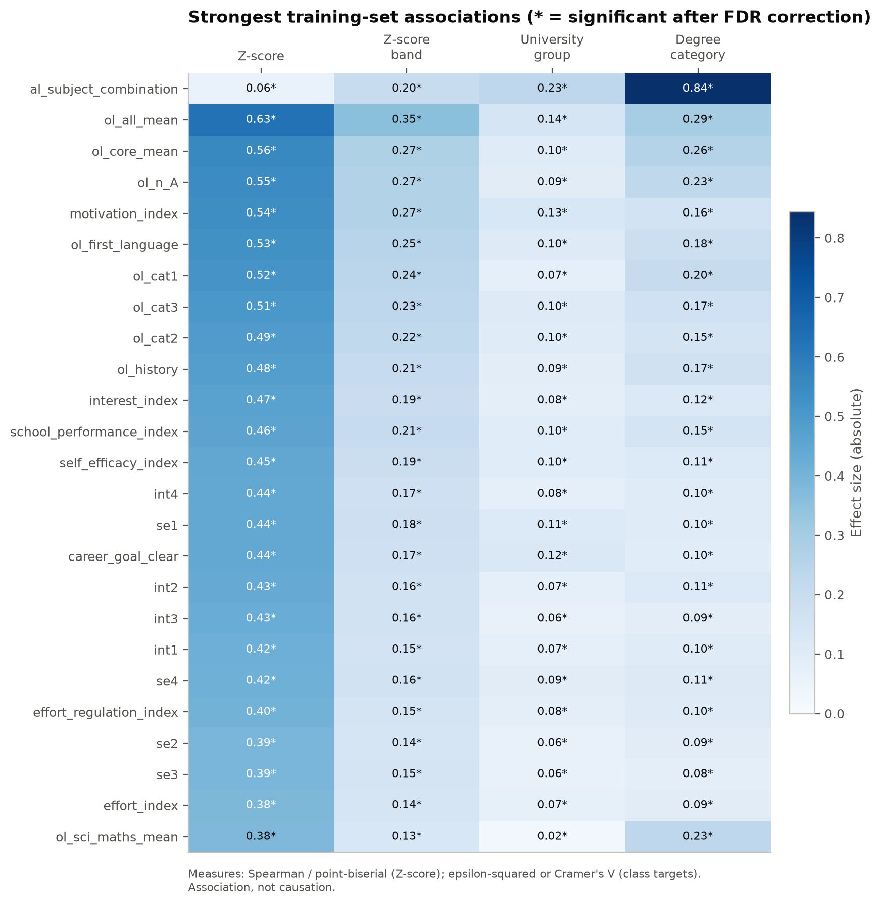

# Phase 4 – Feature Engineering

| | |
|---|---|
| Date | 15 October 2026 |
| Status | Complete. Waiting for approval to start Phase 5. |
| Code | `src/features/build.py` (encoding + pipeline), `src/features/selection.py` (association measures), `src/features/run_phase04.py` (`python -m src.features.run_phase04`); `src/data/split.py` (split, see §2) |
| Settings | `configs/features.yaml`, `configs/split.yaml` |
| Outputs | `models/feature_pipeline.joblib`; `data/processed/features_{train,validation}.csv`; `data/processed/zscore_band_edges.json`; `reports/phase04/` (catalogue, skew, relevance, redundancy, feature sets); `reports/figures/phase04_relevance.png` |

## 1. Purpose

This phase turns the cleaned answers into model inputs:
- encodes grades and answers suitably
- builds meaningful composite features
- handles missing and skewed values
- tests feature selection

**Everything that learns from data is fitted on the training split only.**

## 2. The split had to exist first

The brief requires the data to be split **before anything is fitted** (Phase 5 rule), and this
phase fits transformers. So the split was created first, using exactly the Phase 5 rules. The
Phase 5 document will report the class balance, the cross-validation design and the
class-imbalance handling.

| Setting | Value |
|---|---|
| Rows | 1,014 (M0211 excluded, decision D4) |
| Proportions | 70 / 15 / 15 → **train 709, validation 152, test 153** |
| Seed | 42 (`configs/project.yaml`) |
| Stratified by | degree category × Z-score third (joint key) |
| Small strata | Strata under 10 rows are merged into the neighbouring third of the same degree. Only Medicine had one (1 student in the middle third). |
| Test set | **Locked.** `configs/split.lock.json` stores the SHA-256 of the test IDs. Asking for the test rows raises `TestSetLockedError` unless the Phase 7 unlock word is given. Nothing in this phase read the test rows. |

**Why stratify on two targets.** Stratifying on one target can leave another badly distributed.
Degree category and Z-score are the two targets with the most structure. University-group balance
is checked in Phase 5.

**About the Z-score thirds used for stratification.** These thirds are computed on all modelling
rows, but they are only a stratification key, not a label. The **target** band edges are computed
from the training split only (§4).

## 3. Encoding (fixed rules, nothing learned)

| Inputs | Encoding | Reason |
|---|---|---|
| 9 O/L grades | Ordinal W = 0, S = 1, C = 2, B = 3, A = 4 | Grades are ordered. O/L subjects have no "Not Taken" (every subject is graded). "Not Taken" exists only for A/L subjects, which enter only through the subject combination. |
| Class rank frequency | Never 0 … Always 4 | Ordered answer |
| Grade 11 self-study hours | < 5 = 0 … > 30 = 4 | Ordered ranges |
| O/L tuition subjects | None 0, 1–2 = 1, 3–4 = 2, 5+ = 3 | Ordered ranges |
| Clear career goal | No 0, Not sure 1, Yes 2 | Increasing clarity |
| Grades 6–11 rating, extracurricular rating, 12 attitude items | As answered (1–5); **er4 reversed** (6 − answer) | Phase 1 |
| Stream influences, school activities, leadership roles | One 0/1 column per option (Phase 3) | Tick-all questions |
| Skipped indicators (tuition, activities, leadership) | 0/1 | Researcher's decision: skipped is not the same as "None" |
| Grade 5 result, O/L school type, A/L subject combination | One-hot (unseen categories → all zeros) | Few unordered categories |
| A/L district (25) | One-hot **and** an integer index (0 = unknown) | Many categories. The index is for the entity-embedding model (brief). |
| Gender, A/L exam year, target degree | **Not inputs** | Fairness only / administrative / gap only (Phase 3) |

## 4. Learned settings (fitted on 709 training rows)

| Setting | Learned value / rule | Reason |
|---|---|---|
| Z-score band edges | **1.3314 and 1.7423** → training counts 236 / 236 / 237 | Tertile rule (Phase 3). Frozen and applied to validation and test. |
| Missing numeric values | Training median, plus the skipped indicator | Robust to outliers. The indicator keeps the information that the question was skipped. |
| Missing 0/1 values | Training share of 1s, plus the skipped indicator | Neutral value for a skipped tick-all question |
| Constant columns | Dropped: the three "write-in text" flags (all 0 in training) | They carry no information |
| Skewed variables | |skew| > 1 on training → Yeo-Johnson. Applied to **O/L Religion (−1.04)** and **O/L English (−1.03)**, where most students have an A. | Reduces the pull of the long tail. Every other numeric feature has |skew| ≤ 0.65. |
| Scaling | Standardised with the training mean and SD (numeric and ordinal). One-hot and 0/1 columns unscaled. | Neural networks train better on standardised inputs. |
| Standardised composites | Training means and SDs for the parts of the effort and school-performance indices | The parts are on different scales. |
| District index | Training districts numbered 1–25 | Unseen district → 0 |

**Result:** 98 model columns (41 numeric, 18 binary, 38 one-hot, 1 district index) for every
split, with no missing values. Validation was transformed with the training-fitted pipeline and
never refitted, which a unit test checks.

## 5. Composite features

Each composite is defined in `configs/features.yaml` with its formula and reason. The full
catalogue of all 98 columns is in `reports/phase04/feature_catalogue.csv`.

| Composite | Formula | Reason |
|---|---|---|
| `ol_core_mean` | Mean of the 6 compulsory O/L grades (0–4) | Prior achievement is the most consistent predictor in student-performance studies (Alnasyan et al., 2024). Used in the thesis draft (4.7). |
| `ol_all_mean` | Mean of all 9 O/L grades | Overall O/L achievement, including basket subjects |
| `ol_n_A` | Number of A grades (0–9) | Common Sri Lankan summary of O/L results. Used in the thesis draft. |
| `ol_sci_maths_mean` | Mean of O/L Mathematics and Science | Subject-specific preparation for the Science stream |
| `self_efficacy_index` | Mean of se1–se4 | MSLQ scale score is the item mean (Pintrich et al., 1991). α = 0.93. |
| `effort_regulation_index` | Mean of er1–er3 and reversed er4 | MSLQ effort regulation. α = 0.90. |
| `effort_regulation_index_no_er4` | Mean of er1–er3 | Variant without the weaker reverse-worded item (Phase 1 decision). Chosen on training data in Phase 6. |
| `interest_index` | Mean of int1–int4 | Interest and task value. α = 0.93. |
| `motivation_index` | Mean of the self-efficacy and interest indices | The MSLQ motivation section combines expectancy (self-efficacy) and value components (Pintrich et al., 1991). |
| `effort_index` | Mean of standardised effort regulation and standardised Grade 11 study hours | Persistence plus reported study time |
| `goal_clarity_index` | Mean of career-goal clarity (rescaled 0–1) and "career goals" as a stream influence | Goal-setting theory: specific goals direct effort (Locke & Latham, 2002) |
| `activity_count` | Number of activity types ticked (0–4) | Breadth of school involvement (Fredricks & Eccles, 2006) |
| `leadership_count` | Number of leadership roles ticked (0–6) | Leadership experience (decision D2) |
| `school_performance_index` | Mean of standardised Grades 6–11 rating and class-rank frequency | Self-reported academic standing before O/L |

## 6. Feature-selection tests (training data only)

### 6.1 Measures

The measure follows the data type (project correlation rules):

| Feature type | vs Z-score | vs class targets (band, university group, degree category) |
|---|---|---|
| Numeric / ordinal | Spearman ρ | Kruskal–Wallis ε² |
| 0/1 | Point-biserial r | Cramér's V |
| Nominal | Kruskal–Wallis ε² | Cramér's V |

- **Multiple testing:** p-values are corrected with Benjamini–Hochberg across all 252 tests
  (63 question-level features × 4 targets), α = 0.05.
- **Nominal features** are tested as one variable each, not one test per dummy column.
- **Correlation is not causation.** These are associations in 709 training students. They do not
  show that changing an answer would change a result.
- **Effect sizes are not comparable across columns.** The measures differ (ρ, ε², V), so a value
  should only be compared with others measured the same way.

### 6.2 Results

**146 of 252 feature–target pairs are significant** after correction:

| Target | Significant features |
|---|---|
| Z-score | 36 |
| Z-score band | 38 |
| University group | 35 |
| Degree category | 37 |

Full table: `reports/phase04/relevance_train.csv`.

*Figure 4.1 – The 25 features with the strongest association with any target (absolute effect
size; * = significant after FDR correction).*

Plain-language summary (association only):

- **Z-score and band.** The strongest associations are the O/L grade summaries:
  - all-subject mean ρ = 0.63
  - core mean 0.56
  - number of A grades 0.55

  These are followed by the motivation index (0.54), individual O/L grades (0.48–0.53) and the
  attitude indices (0.40–0.47).
- **Degree category.** It is dominated by the A/L subject combination (Cramér's V = 0.84), as
  expected from Phase 3 §4.5. O/L grade summaries come next (ε² 0.23–0.29).
- **University group.** The associations are weaker. The strongest is the subject combination
  (V = 0.23); the O/L and attitude measures are all ≤ 0.14. District is not significant
  (V = 0.19, adjusted p = 0.48). With 25 categories, Cramér's V is biased upwards, so the test
  result is the better guide.
- **No association with any target.** These features show none:
  - school activities and leadership (each option, the counts and the skipped flags)
  - extracurricular rating
  - Grade 5 result
  - O/L tuition (and its skipped flag)
  - three of the five stream influences (parents, friends, career goals)
  - O/L English and Religion (both mostly A grades, so little variation)
  - district

### 6.3 Redundancy

There are **17 pairs with |ρ| > 0.90** (`reports/phase04/redundancy_train.csv`). Nearly all are a
composite and its own items: each attitude item with its index, the two effort-regulation
variants, the effort index with its parts, and the core mean with the all-subject mean. This is
expected and not a data problem.

### 6.4 Candidate feature sets (final choice in Phase 6, by cross-validation on training data)

| Set | Columns | Content |
|---|---|---|
| `full` | 97 (+ district index for the embedding model) | Every input feature and composite |
| `composites` | 85 | Attitude items replaced by their indices; everything else kept |
| `filtered` | 34 | Features associated with at least one target after FDR correction, minus the redundant member of each pair. Preference order: composites first, so the interpretable summary is kept. A feature is only dropped in favour of one that is itself kept. Dropped as redundant: se1–se4, int1–int4, er2, `ol_all_mean`, `effort_index`, `effort_regulation_index_no_er4`. Kept: er1, er3 and er4 (no kept feature duplicates them above 0.90) and Grade 11 study hours. |

The three sets are compared in Phase 6, inside training-set cross-validation, with the same model
budget. No set is chosen by looking at validation or test scores alone.

**Note on er4.** The `full` and `composites` sets contain both effort-regulation variants, so
Phase 6 can compare them as agreed. The `filtered` set keeps the version with er4 because it is
listed first.

## 7. Problems found

1. **Many questions show no association with any target in training data:** activities,
   leadership, tuition, Grade 5 and district. The `filtered` set leaves them out. Whether leaving
   them out helps or hurts is tested in Phase 6, not assumed.
2. **The degree category is close to being fixed by the subject combination** (V = 0.84).
   Phase 7 will also report the scores within each subject combination.
3. **O/L English and Religion have little variation** (mostly A grades) and are strongly skewed.
   They are transformed but carry little information.
4. **The relevance figure mixes different measures.** Values should only be compared within one
   measure. The caption says so.

## 8. Tests

52 unit tests pass and ruff reports no problems. The new tests check:

- grade coding and er4 reversal
- composite formulas
- rejection of unknown labels
- selection of tick-all option columns
- the pipeline never refitting on other data
- unseen districts mapping to "unknown"
- training features being standardised
- Cramér's V and ε² at their limits
- redundancy resolution keeping the preferred feature, and never dropping both ends of a chain (a first version of the code lost Grade 11 study hours this way; found and fixed in this phase)
- merging of small strata
- split proportions and disjoint IDs
- the test set lock

## 9. What the next phase needs (Phase 5: data splitting)

The split already exists (§2). Phase 5 will:

- report the class balance of every target in train, validation and test (test counts only, with
  no other look at the test rows)
- build and save the repeated stratified 5-fold cross-validation folds inside the training set
  (3 repeats, seed-fixed)
- measure class imbalance on training data and set the handling rule (class weights computed on
  training folds only)
