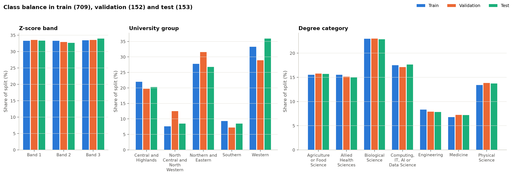

# Phase 5 – Data Splitting

| | |
|---|---|
| Date | 15 October 2026 |
| Status | Complete. Waiting for approval to start Phase 6. |
| Code | `src/data/split.py` (split and lock, created in Phase 4), `src/data/imbalance.py`, `src/data/run_phase05.py` (`python -m src.data.run_phase05`) |
| Settings | `configs/split.yaml` |
| Outputs | `reports/phase05/` (balance per target, Z-score per split, imbalance, fold balance, summary); `data/processed/cv_folds.csv` (not committed); `reports/figures/phase05_class_balance.png` |

## 1. Purpose

This phase does four things:

- makes sure the train / validation / test split is fair for every target
- keeps the test set locked
- fixes the cross-validation folds used for tuning
- decides how class imbalance is handled

All of this is done before any model is trained.

## 2. The split (recap)

The split was created at the start of Phase 4, because the brief requires the split to exist
before anything is fitted. It used the rules set for this phase.

| Setting | Value |
|---|---|
| Modelling rows | 1,014 (M0211 excluded, decision D4) |
| Proportions | 70 / 15 / 15 → **train 709 · validation 152 · test 153** (brief's estimate for 1,029 rows: about 720 / 155 / 154) |
| Seed | 42 |
| Stratified by | Degree category × Z-score third. Strata under 10 rows are merged into the neighbouring third of the same degree (only Medicine needed this). |
| Lock | `configs/split.lock.json`: SHA-256 of the test IDs and of the whole split file. The split cannot be re-created, and any change to it is detected. |
| Test access | `load_split_rows("test")` raises `TestSetLockedError` without the Phase 7 unlock word. |

**What this phase read from the test set.** The brief asks for the class balance of every split,
so this phase counted the **target labels** of the test rows. No answers or features of test rows
were read, and these counts are not used in any modelling decision.

## 3. Class balance in each split

*Figure 5.1 – Share of each class in train, validation and test.*

### Z-score band (ordered; edges 1.3314 and 1.7423 from training)

| Band | Train | Validation | Test |
|---|---|---|---|
| Band 1 (lower third) | 236 (33.3 %) | 51 (33.6 %) | 51 (33.3 %) |
| Band 2 (middle third) | 236 (33.3 %) | 50 (32.9 %) | 50 (32.7 %) |
| Band 3 (upper third) | 237 (33.4 %) | 51 (33.6 %) | 52 (34.0 %) |

### Degree category (unordered; part of the stratification)

| Category | Train | Validation | Test |
|---|---|---|---|
| Biological Science | 163 (23.0 %) | 35 (23.0 %) | 35 (22.9 %) |
| Computing, IT, AI or Data Science | 124 (17.5 %) | 26 (17.1 %) | 27 (17.6 %) |
| Agriculture or Food Science | 110 (15.5 %) | 24 (15.8 %) | 24 (15.7 %) |
| Allied Health Sciences | 110 (15.5 %) | 23 (15.1 %) | 23 (15.0 %) |
| Physical Science | 95 (13.4 %) | 21 (13.8 %) | 21 (13.7 %) |
| Engineering | 59 (8.3 %) | 12 (7.9 %) | 12 (7.8 %) |
| Medicine | 48 (6.8 %) | 11 (7.2 %) | 11 (7.2 %) |

### University group (unordered; *not* part of the stratification)

| Group | Train | Validation | Test |
|---|---|---|---|
| Western | 236 (33.3 %) | 44 (28.9 %) | 55 (35.9 %) |
| Northern and Eastern | 197 (27.8 %) | 48 (31.6 %) | 41 (26.8 %) |
| Central and Highlands | 156 (22.0 %) | 30 (19.7 %) | 31 (20.3 %) |
| Southern | 66 (9.3 %) | 11 (7.2 %) | 13 (8.5 %) |
| North Central and North Western | 54 (7.6 %) | 19 (12.5 %) | 13 (8.5 %) |

### Z-score (number)

| Split | n | Mean | SD | Min | Median | Max |
|---|---|---|---|---|---|---|
| Train | 709 | 1.548 | 0.422 | 0.754 | 1.529 | 2.611 |
| Validation | 152 | 1.530 | 0.423 | 0.753 | 1.493 | 2.414 |
| Test | 153 | 1.535 | 0.435 | 0.778 | 1.514 | 2.385 |

### Gender (for the fairness check only, not an input)

| | Train | Validation | Test |
|---|---|---|---|
| Female | 363 (51.2 %) | 84 (55.3 %) | 72 (47.1 %) |
| Male | 346 (48.8 %) | 68 (44.7 %) | 81 (52.9 %) |

**Reading the tables:**
- **Band and degree category:** the class shares agree within 0.6 percentage points across the
  three splits, because both were part of the stratification.
- **Z-score:** its distribution is almost the same in all three splits.
- **University group:** this was not stratified (stratifying on three targets would make the
  strata too small), and its shares differ by up to **7 percentage points**. The largest
  difference is North Central / North Western: 7.6 % of train but 12.5 % of validation.
- **Gender:** the shares differ by up to 8 points. That still leaves 72–84 students of each
  gender in validation and test for the fairness check.

**What follows for university group:**
- The split is **not** redone. It is locked, and re-drawing a split until it "looks better"
  would be split tuning, which the brief forbids.
- Macro F1 and balanced accuracy weight every class equally, so they are not distorted by these
  differences.
- The confidence intervals in Phase 7 show the remaining uncertainty.
- The Phase 7 report will mention the difference.

## 4. Class imbalance and how it is handled

The imbalance ratio is the largest class divided by the smallest, measured on the training split
only.

| Target | Imbalance ratio | Handling |
|---|---|---|
| Z-score band | 1.00 | None needed: balanced by construction |
| University group | **4.37** (236 vs 54) | **Balanced class weights in the loss** |
| Degree category | **3.40** (163 vs 48) | **Balanced class weights in the loss** |

**Rule** (`configs/split.yaml`): a target with a training ratio above 1.5 gets balanced class
weights, calculated as w = n / (k × class count). This gives rare classes more weight while the
average weight per training row stays 1.

**Weights on the full training split:**

| Target | Weights |
|---|---|
| University group | North Central and North Western 2.63 · Southern 2.15 · Central and Highlands 0.91 · Northern and Eastern 0.72 · Western 0.60 |
| Degree category | Medicine 2.11 · Engineering 1.72 · Physical Science 1.07 · Allied Health 0.92 · Agriculture or Food Science 0.92 · Computing 0.82 · Biological Science 0.62 |

**Why weights rather than resampling.**
- Oversampling methods such as SMOTE create synthetic students whose answers nobody gave. That
  conflicts with the project's data-honesty rules.
- Undersampling would throw away real answers from an already small dataset.
- Class weights change only how much each real student counts in the loss.

**Weights are always computed from the rows being trained on.** Inside cross-validation they are
recalculated on the training part of each fold. Validation and test labels are never used to set
weights.

## 5. Cross-validation folds (inside the training split only)

| Setting | Value |
|---|---|
| Scheme | Repeated stratified 5-fold, 3 repeats (15 folds), seed 42 |
| Stratified by | The same degree × Z-score-third key. The smallest training stratum has 11 rows, enough for 5 folds. |
| Fold size | 141–142 held-out rows; about 567 training rows per fold |
| Saved as | `data/processed/cv_folds.csv` (one row per training student per repeat: repeat, fold) |

**How well each fold matches the whole training split** (largest difference in any class share,
across all 15 folds):

| Target | Largest difference |
|---|---|
| Degree category | 0.6 percentage points |
| Z-score band | 1.2 percentage points |
| University group | 6.7 percentage points |

**How Phase 6 must use the folds (no leakage inside cross-validation):**
1. The feature pipeline is **re-fitted on the training part of each fold**. The held-out part is
   transformed with that fold's fitted pipeline: medians, scaling, skew transforms and one-hot
   categories.
2. Class weights are recalculated on the training part of each fold.
3. The Z-score band edges stay as the frozen training-split edges. They define the labels and are
   not a feature transformer.
4. Early stopping must not look at the held-out fold it is then scored on. Phase 6 will hold out
   a small early-stopping part from each fold's training rows.

## 6. Problems found

1. **The university group is less evenly spread across the splits (up to 7 points) than the
   stratified targets.** Accepted and reported, not fixed by re-splitting.
2. **The test set is small (153).** The bootstrap confidence intervals (Phase 2 §6.1) will show
   how uncertain each test score is. The smallest test classes are Medicine (11), Engineering (12)
   and Southern / North Central and North Western (13 each).

## 7. Tests

54 unit tests pass and ruff reports no problems. The new tests check that:

- the balanced weights are correct and average one per row
- the imbalance ratio and weighting rule work
- every training row appears in exactly one held-out fold per repeat
- the folds are of equal size

## 8. What the next phase needs (Phase 6: train and tune all models)

Everything Phase 6 needs is in place:

- the locked criteria (Phase 2)
- the features and three candidate feature sets (Phase 4)
- the folds and the imbalance rule (this phase)

Two points need the researcher's input at the start of Phase 6:

1. **Tuning budget.** Every model gets the same budget. The proposal has three steps:
   1. **Choose the feature set.** Compare the three feature sets with one fixed default
      configuration per model (8 models × 3 sets × 15 folds).
   2. **Tune each model** on the chosen set by **random search, 20 configurations per model**,
      each scored by the 15-fold cross-validation.
   3. **Re-run the chosen configuration** with 5 seeds.

   TabPFN has almost nothing to tune, so it gets steps 1 and 3 only. Small networks on about 570
   rows train quickly, but this is still several thousand fits. Expect roughly a day of CPU time,
   run in the background. Please confirm, or say if you want a smaller budget, e.g. 10
   configurations.
2. **TabPFN weights.** TabPFN downloads its pretrained weights from the internet the first time it
   runs, and its licence must be accepted. Please confirm that downloading it is acceptable.
