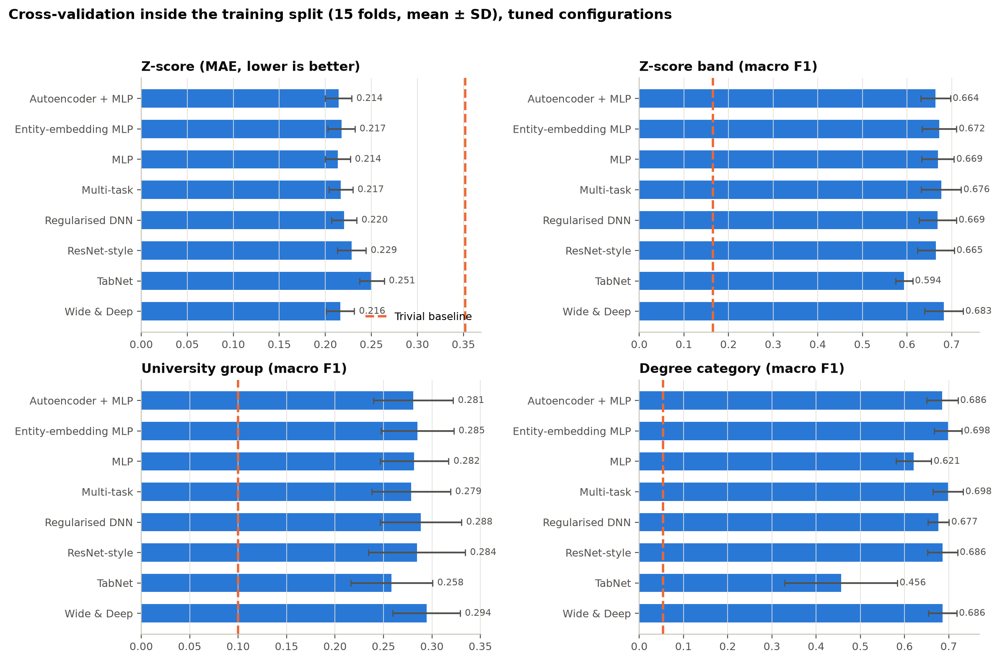
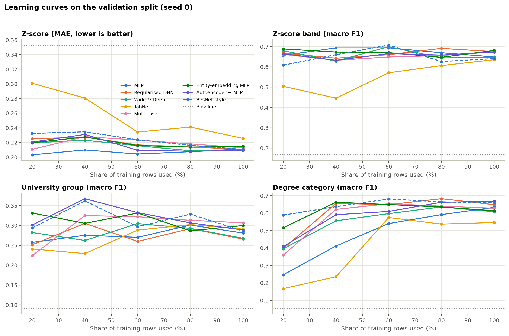
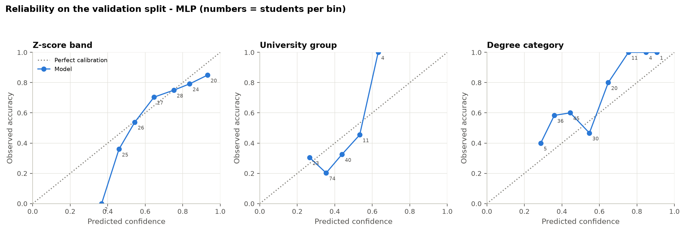
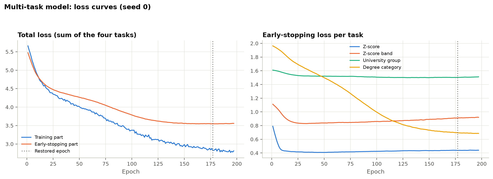
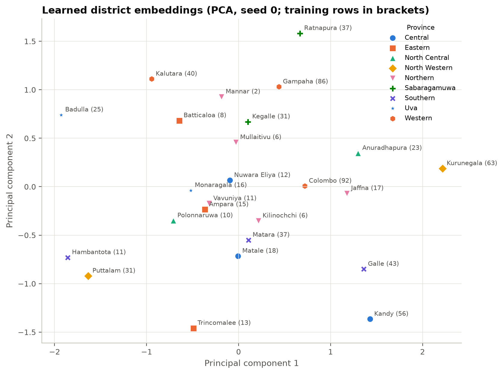

# Phase 6 – Train and Tune All Models

| | |
|---|---|
| Date | 15 October 2026 |
| Status | Complete. Waiting for approval to start Phase 7 (test). |
| Code | `src/models/networks.py` (8 architectures), `src/models/train.py` (one training loop), `src/models/data.py`, `src/models/cv.py` (cross-validation, run log, random search), `src/models/run_phase06.py` (part 1 and Stage 2), `src/models/run_phase06_final.py` + `src/models/phase06_analysis.py` (part 2), `src/evaluation/metrics.py`, `src/evaluation/bootstrap.py` |
| Settings | `configs/models.yaml`, `configs/geography.yaml` |
| Run log | `reports/phase06/runs.jsonl`: **5,590 training runs**, each with its step, model, configuration, seed, fold, every metric, baseline, epochs, time and parameters |
| Results | `reports/phase06/*.csv`, `decisions.json`, `weakness.json`; figures `reports/figures/phase06_*.png` |
| Test set | **Not read.** All Phase 4 guards stayed in place. |

## 0. Summary in plain words

- **What was done:**
  - Eight kinds of neural network were each tried with 20 different settings.
  - Every setting was tested on 15 different slices of the training data.
  - The best settings were then checked on the separate validation students.
- **How the models compare:**
  - All eight are **much better than guessing** (the "trivial baseline") on all four targets.
  - Seven of them are **about equally good**.
  - **TabNet is clearly the weakest.**
- **Which model was chosen:**
  - Because the top models could not be told apart reliably, the locked rule chose the **simplest network, the plain MLP**.
  - When the MLP predicts all four targets together, it is slightly worse at the **Z-score** than an MLP that predicts the Z-score alone ("negative transfer").
  - Following the locked rule, the system therefore uses **two small MLPs**:
    - **one** predicts the Z-score band, university group and degree category
    - **one** predicts the Z-score number
- **Validation results of the chosen system** (152 students not used for training):

  | Target | Score | Simple guess |
  |---|---|---|
  | Z-score | Average error 0.209 Z-points | 0.354 |
  | Z-score band | Macro F1 0.67 | 0.17 |
  | University group | Macro F1 0.32 | 0.09 |
  | Degree category | Macro F1 0.62 | 0.05 |

- **Weak spots:**
  - University group is predicted only modestly.
  - The MLP's confidence for degree category is less well calibrated (ECE 0.12, above the 0.10 limit).

These are validation results. The final, official numbers come from the locked test set in Phase 7.

## 1. Purpose

This phase:

- trains every allowed neural network on the same splits and features
- tunes each one with the same documented budget
- chooses using **training-set cross-validation and the validation split only**
- computes every check the brief asks for

All of this happens before the test set is opened.

## 2. The eight architectures

**No ensembles.** Repeated seeds are only used to report the spread of the scores. TabPFN is not
used (Phase 2 addendum).

Every architecture is **one network with four outputs** (Stage 1 of the locked rule).

| Model | What it is |
|---|---|
| MLP | Plain multilayer perceptron, no dropout, no L2 |
| Regularised DNN | Batch normalisation, dropout and L2 |
| Wide & Deep | Linear part on the inputs **plus 13 hand-made cross features**, added to a deep part |
| TabNet | Attention-based tabular network, one output mapping per task |
| Multi-task variant | Shared trunk, one tower per task, learned loss weights (Kendall et al., 2018) |
| Entity-embedding MLP | Learned embedding for the 25 districts |
| Autoencoder + MLP | Autoencoder fitted on the training rows only; MLP on the compressed codes |
| ResNet-style | Residual blocks with batch normalisation (Gorishniy et al., 2021) |

## 3. One training procedure for all

| Setting | Value |
|---|---|
| Optimiser | Adam; at most 300 epochs |
| Losses | MSE on the standardised Z-score. Cross-entropy for the classes, with **balanced class weights** for university group and degree category, computed from the rows being trained on. |
| Early stopping | 10 % of the rows being trained on are held out. Patience is tuned (10 / 20 / 30). The best weights are restored. The rows that are scored afterwards are never used. |
| Inside cross-validation | The feature pipeline and the class weights are re-fitted on each fold's training part. |
| Seeds | Search: seed 0. Chosen settings: seeds 0–4, reporting the mean ± SD of the scores. |
| Compute | About 5.6 CPU-hours for the search, run on 14 parallel workers |

## 4. Decision rules (written before the runs)

| Step | What | Rule |
|---|---|---|
| 1 | Three feature sets, each model's default settings, 15 folds | Lowest mean rank over models, folds and targets |
| 1b | Effort-regulation score with or without er4 | Lowest mean rank; a tie goes to "with er4" |
| 2 | **Random search:** 20 settings per model (the default plus 19 seeded random draws), 15 folds | Best mean rank. Settings within 1 SD of the best count as tied, and the one with the fewest parameters is chosen. |
| 3 | Architecture (locked Stage 1) | Same mean-rank and 1-SD rule |
| 4 | Weakness (locked Stage 2) | (a) CV primary metric misses the minimum against the baseline, or (b) negative transfer against a single-task network (paired bootstrap on validation; the CI excludes 0) |
| 5 | For each weak target | The same search, single-output, for all eight architectures; the same selection rules |

**A property of the 1-SD tie rule.**
- The ranks vary a lot from fold to fold (SD about 1–3 rank places).
- So the "tied" group is often large, and the rule then picks the smallest network.
- This is why many of the chosen settings are small networks (e.g. the MLP has one layer of 32
  units), even where a larger setting had a slightly better mean rank.
- The rule was fixed before the results were seen and was **not changed afterwards**. Changing it
  would be tuning to the results.

## 5. Results

### 5.1 Step 1: feature set

| Feature set | Columns | Mean rank (1 = best) | SD over models |
|---|---|---|---|
| **filtered** | 34 | **1.60** | 0.08 |
| full | 97 | 2.16 | 0.10 |
| composites | 85 | 2.25 | 0.15 |

**Chosen: `filtered`.**

### 5.2 Step 1b: er4

| Variant | Mean rank |
|---|---|
| **with er4** | **1.42** |
| without er4 | 1.58 |

**Chosen: keep er4.** Final input: **34 columns** (`reports/phase06/final_columns.json`).

### 5.3 Step 2: tuned settings (random search, 20 per model)

| Model | Chosen setting | Parameters |
|---|---|---|
| MLP | 1 layer × 32 units, lr 1.3e-4, batch 64 | 1,648 |
| Regularised DNN | 2 × 64, dropout 0.45, L2 1.2e-6, lr 1.6e-3, batch 128 | 7,696 |
| Wide & Deep | deep 1 × 32, dropout 0.26, lr 1.0e-4, batch 32 | 2,416 |
| TabNet | n_d = n_a = 8, 3 steps, γ 1.63, λ_sparse 6.9e-4, lr 0.016 | 8,004 |
| Multi-task | shared 1 × 128, towers 16, dropout 0.43, lr 1.4e-4, batch 32 | 13,012 |
| Entity-embedding MLP | 1 × 128, embedding size 2, dropout 0.48, lr 2.8e-4, batch 32 | 6,852 |
| Autoencoder + MLP | bottleneck 32, AE hidden 64, MLP 2 × 64, dropout 0.21 | 15,954 |
| ResNet-style | 1 block × 64, dropout 0.40, lr 5.0e-4, batch 128 | 11,856 |

Full ranks are in `step2_search_ranks.csv`, and every setting is in `runs.jsonl`.

### 5.4 Cross-validation of the tuned settings (15 folds, mean ± SD)

| Model | Z-score MAE ↓ | Band macro F1 | University group macro F1 | Degree category macro F1 |
|---|---|---|---|---|
| *Trivial baseline* | *0.352* | *0.165* | *0.100* | *0.053* |
| MLP | 0.214 ± 0.014 | 0.669 ± 0.036 | 0.282 ± 0.035 | 0.621 ± 0.040 |
| Regularised DNN | 0.220 ± 0.014 | 0.669 ± 0.042 | 0.288 ± 0.042 | 0.677 ± 0.024 |
| Wide & Deep | 0.216 ± 0.015 | **0.683 ± 0.043** | **0.294 ± 0.035** | 0.686 ± 0.032 |
| TabNet | 0.251 ± 0.013 | 0.594 ± 0.019 | 0.258 ± 0.042 | 0.456 ± 0.127 |
| Multi-task | 0.217 ± 0.013 | 0.676 ± 0.045 | 0.279 ± 0.040 | **0.698 ± 0.034** |
| Entity-embedding MLP | 0.217 ± 0.015 | 0.672 ± 0.039 | 0.285 ± 0.038 | **0.698 ± 0.031** |
| Autoencoder + MLP | **0.214 ± 0.014** | 0.664 ± 0.033 | 0.281 ± 0.041 | 0.686 ± 0.035 |
| ResNet-style | 0.229 ± 0.015 | 0.665 ± 0.041 | 0.284 ± 0.050 | 0.686 ± 0.034 |

*Figure 6.1 – Cross-validated primary metric per model (mean ± SD over 15 folds). The dashed line
is the trivial baseline.*

**Stability** (locked limits: F1 SD ≤ 0.05; MAE SD / mean ≤ 0.10). Every model is stable except
**TabNet on degree category** (SD 0.127), whose score swings widely between folds.

### 5.5 Step 3: architecture selection

| Model | Mean rank (over 15 folds × 4 targets) | SD | Parameters |
|---|---|---|---|
| Wide & Deep | **3.35** | 1.24 | 2,416 |
| Entity-embedding MLP | 3.74 | 0.94 | 6,852 |
| Multi-task | 3.82 | 1.22 | 13,012 |
| Autoencoder + MLP | 3.88 | 0.99 | 15,954 |
| Regularised DNN | 4.44 | 0.96 | 7,696 |
| **MLP** | 4.58 | 0.74 | **1,648** |
| ResNet-style | 4.88 | 0.55 | 11,856 |
| TabNet | 7.32 | 0.84 | 8,004 |

**How the rule decided:**
- Wide & Deep has the best mean rank.
- Every model within one SD of it (rank ≤ 4.59) counts as tied: six models.
- Of those six, the **MLP has the fewest parameters**, so the MLP is selected.

**In plain words:** on this data the top models cannot be separated reliably, so the simplest one
is used. The thesis draft's earlier finding was similar: the networks "performed within a few
responses of one another".

**Note:** the MLP's cross-validated degree-category score (0.62) is below most other models'
(about 0.69). The averaged rank hides this one weaker target.

### 5.6 Step 4: weakness check of the selected multi-output MLP

**(a) Minimum against the baseline (CV means).** All four targets pass:

| Target | Result | Minimum |
|---|---|---|
| Z-score | MAE 39 % lower than the baseline | ≥ 10 % |
| Z-score band | Macro F1 +0.50 | ≥ +0.10 |
| University group | Macro F1 +0.18 | ≥ +0.10 |
| Degree category | Macro F1 +0.57 | ≥ +0.10 |

**(b) Negative transfer.** The multi-output network was compared with single-task networks of the
same architecture and settings: 5 seeds each, plus a paired bootstrap on the 152 validation
students for seed 0.

| Network | Task | Multi-output | Single-task | Difference (seed 0, higher = multi better) [95 % CI] | Verdict |
|---|---|---|---|---|---|
| MLP | Z-score (MAE) | 0.215 ± 0.004 | 0.209 ± 0.005 | −0.009 [−0.018, −0.002] | **Negative transfer** |
| MLP | Band (F1) | 0.666 ± 0.016 | 0.664 ± 0.021 | −0.049 [−0.100, 0.002] | none detected |
| MLP | University group (F1) | 0.317 ± 0.039 | 0.259 ± 0.058 | −0.009 [−0.079, 0.060] | none detected |
| MLP | Degree category (F1) | 0.617 ± 0.017 | 0.628 ± 0.013 | −0.005 [−0.047, 0.031] | none detected |
| Multi-task | Z-score (MAE) | 0.210 ± 0.003 | 0.206 ± 0.003 | −0.010 [−0.022, 0.001] | none detected |
| Multi-task | Band (F1) | 0.654 ± 0.014 | 0.667 ± 0.013 | 0.003 [−0.039, 0.045] | none detected |
| Multi-task | University group (F1) | 0.309 ± 0.020 | 0.258 ± 0.054 | 0.003 [−0.053, 0.058] | none detected |
| Multi-task | Degree category (F1) | 0.637 ± 0.017 | 0.640 ± 0.011 | −0.011 [−0.043, 0.016] | none detected |

**Result: the MLP is weak for the Z-score only** (rule b). The multi-task variant shows no
detectable negative transfer on any task. Its university-group score is also clearly better than
its single-task version on average over seeds (0.309 vs 0.258), but that difference is not
significant for seed 0.

### 5.7 Step 5: Stage 2 for the Z-score

All eight architectures were searched again with **one output head (Z-score only)**: the same 20
settings each, 15 folds, the same rules.

| Model | Mean rank | SD | Parameters | CV MAE |
|---|---|---|---|---|
| Multi-task (single head) | **2.53** | 1.30 | 6,562 | 0.215 |
| Autoencoder + MLP | 3.00 | 1.36 | 11,843 | 0.216 |
| **MLP** | 3.13 | 1.96 | **1,153** | 0.217 |
| Wide & Deep | 3.53 | 2.03 | 1,201 | 0.218 |
| Entity-embedding MLP | 4.53 | 2.07 | 3,497 | 0.219 |
| Regularised DNN | 4.93 | 1.44 | 11,009 | 0.221 |
| ResNet-style | 6.33 | 0.82 | 10,881 | 0.225 |
| TabNet | 8.00 | 0.00 | 7,884 | 0.259 |

**Chosen: the single-output MLP** (same setting c12: 1 × 32 units), by the same tie rule.

**Validation, 5 seeds:**

| Measure | Value |
|---|---|
| MAE | **0.209 ± 0.005** |
| RMSE | 0.268 |
| R² | 0.60 |
| Spearman | 0.76 |
| Train–validation gap | 4 % (limit 20 %) |

It is better than the multi-output MLP's Z-score: the paired difference in MAE is 0.0095, with
95 % CI [0.0018, 0.0177].

### 5.8 The prediction system that goes to Phase 7

| Output | Network |
|---|---|
| Z-score band, university group, degree category | **Multi-output MLP** (1 × 32 units, 1,648 parameters) |
| Z-score number | **Single-output MLP** (1 × 32 units, 1,153 parameters) |

This is the researcher's rule in action: "one model first, change it if it shows weakness". All
eight multi-output models (and the Stage-2 model) are also evaluated on the test set in Phase 7, so
the comparison is reported in full.

### 5.9 Validation results for every model (5 seeds, mean ± SD)

| Model | Z-score MAE ↓ | Band F1 | University group F1 | Degree category F1 | Parameters | Mean best epoch | Seconds per fit |
|---|---|---|---|---|---|---|---|
| *Trivial baseline* | *0.354* | *0.167* | *0.090* | *0.053* | | | |
| MLP | 0.215 ± 0.004 | 0.666 ± 0.016 | 0.317 ± 0.039 | 0.617 ± 0.017 | 1,648 | 300 (cap) | 8.6 |
| Regularised DNN | 0.212 ± 0.002 | 0.657 ± 0.016 | 0.277 ± 0.028 | 0.653 ± 0.018 | 7,696 | 66 | 2.5 |
| Wide & Deep | 0.213 ± 0.002 | 0.663 ± 0.015 | 0.299 ± 0.021 | 0.617 ± 0.014 | 2,416 | 299 (cap) | 28.1 |
| TabNet | 0.234 ± 0.007 | 0.638 ± 0.032 | 0.285 ± 0.023 | 0.508 ± 0.083 | 8,004 | 66 | 13.3 |
| Multi-task | 0.210 ± 0.003 | 0.654 ± 0.014 | 0.309 ± 0.020 | 0.637 ± 0.017 | 13,012 | 192 | 22.7 |
| Entity-embedding MLP | 0.213 ± 0.001 | 0.674 ± 0.009 | 0.311 ± 0.029 | 0.628 ± 0.012 | 6,852 | 128 | 14.0 |
| Autoencoder + MLP | 0.210 ± 0.002 | 0.667 ± 0.005 | 0.309 ± 0.030 | 0.658 ± 0.017 | 15,954 | 77 | 14.8 |
| ResNet-style | 0.217 ± 0.006 | 0.639 ± 0.019 | 0.300 ± 0.017 | 0.646 ± 0.014 | 11,856 | 73 | 2.8 |
| **Stage-2 MLP (Z-score only)** | **0.209 ± 0.005** | – | – | – | 1,153 | 132 | – |

Every other metric of the brief is in `validation_metrics_long.csv`: RMSE, R², Spearman;
accuracy, balanced accuracy, per-class precision and recall, confusion matrices, QWK,
within-one-band accuracy, ROC-AUC and log loss.

**Early stopping hit the 300-epoch cap for the MLP and Wide & Deep.** Their tuned learning rates are
very small (about 1e-4), so validation loss was still slowly improving at epoch 300. The cap was
fixed in advance and is reported, not changed.

### 5.10 Train–validation gap (limits: macro F1 ≤ 0.10; MAE ≤ 20 % relative)

| Model | Within all limits? | Over the limit |
|---|---|---|
| **MLP** | **Yes** | – |
| Autoencoder + MLP | Yes | – |
| TabNet | Yes | – |
| Stage-2 MLP | Yes (4 %) | – |
| Regularised DNN | No | University group 0.103 |
| Wide & Deep | No | University group 0.110, degree 0.115 |
| Multi-task | No | Band 0.115, degree 0.108 |
| Entity-embedding MLP | No | University group 0.139, degree 0.128 |
| ResNet-style | No | All four targets (Z-score 24 %, band 0.117, university 0.137, degree 0.105) |

Full table: `train_validation_gap.csv`. The chosen MLPs overfit least, which supports choosing the
simpler network.

### 5.11 Learning curves

*Figure 6.2 – Validation score when trained on 20–100 % of the training rows (seed 0).*

- **Z-score and band:** the curves are nearly flat from 20 % onwards. More of the same kind of data
  would help little.
- **Degree category:** the score rises steadily with more data for most models, so more data
  would help here.
- **TabNet** needs the most data.

### 5.12 Calibration on validation (locked limit: ECE ≤ 0.10)

| Model | Band ECE | University group ECE | Degree category ECE |
|---|---|---|---|
| **MLP** | 0.064 ✓ | 0.079 ✓ | **0.120 ✗** |
| Regularised DNN | 0.072 | 0.125 ✗ | 0.088 |
| Wide & Deep | 0.066 | 0.108 ✗ | 0.071 |
| TabNet | 0.071 | 0.089 | 0.085 |
| Multi-task | 0.086 | 0.099 | 0.069 |
| Entity-embedding MLP | 0.070 | 0.090 | 0.075 |
| Autoencoder + MLP | 0.056 | 0.102 ✗ | 0.072 |
| ResNet-style | 0.058 | 0.118 ✗ | 0.071 |

**Brier score.** Every model's Brier score is below the class-frequency baseline for every class
target. For example, MLP degree category scores 0.54 against a baseline of 0.84.

*Figure 6.3 – Reliability of the chosen MLP on validation. For degree category the points lie
above the diagonal: the MLP is **under-confident** (it is right more often than its probability
says).*

**Temperature scaling.** The temperature was fitted on the validation split (seed 0) and stored in
`temperatures_seed0.json`. For MLP degree category it is T = 0.66, which sharpens the
probabilities. It **cannot be judged on the same validation rows it was fitted on**, so its effect
is reported on the test set in Phase 7. Phase 7 will report the test ECE both with and without
scaling.

### 5.13 Model-specific checks (validation, 5 seeds)

**MLP:**
- Seed spread on validation is small: Z-score MAE SD 0.004; F1 SD 0.016–0.039 (the largest is for
  university group).
- Gap and learning curve: see above.

**Regularised DNN (ablation)** (`check_reg_dnn_ablation.csv`):

| Variant | Z-score MAE | Band F1 | University group F1 | Degree category F1 | Early-stopping epoch |
|---|---|---|---|---|---|
| Tuned (dropout 0.45 + L2 1.2e-6) | 0.212 | 0.657 | 0.277 | 0.653 | 66 |
| Dropout only | 0.212 | 0.662 | 0.277 | 0.656 | 70 |
| L2 only | 0.229 | 0.649 | 0.286 | 0.645 | 19 |
| Neither | 0.229 | 0.649 | 0.290 | 0.643 | 19 |

- **Dropout does the work.** Without it the network overfits by about epoch 19 and the Z-score
  error rises by 8 %.
- The tuned L2 is tiny and makes no measurable difference.

**Wide & Deep (ablation)** (`check_wide_deep_ablation.csv`):

| Variant | Z-score MAE | Band F1 | University group F1 | Degree category F1 |
|---|---|---|---|---|
| Both (tuned) | 0.213 | 0.663 | 0.299 | 0.617 |
| Wide only | 0.210 | 0.661 | **0.322** | 0.613 |
| Deep only | 0.212 | **0.669** | 0.314 | **0.644** |
| Both, without crosses | 0.216 | 0.660 | 0.303 | 0.629 |

- Neither part clearly beats the other.
- The **hand-made cross features matter little**. Shuffling all 13 cross columns lowers validation
  degree F1 by 0.031 ± 0.028 and band F1 by 0.013 ± 0.024. Z-score MAE changes by less than 0.005,
  and university group does not drop (−0.018).
- ROC-AUC for all Wide & Deep classifiers is in `validation_metrics_long.csv`.

**TabNet** (`check_tabnet_mask_importance.csv`):
- **Attention masks are very sparse:** 93 % of mask entries are exactly zero.
- **Top features by mask importance:**
  - subject combination "Physics + Combined Maths + ICT" (0.15)
  - O/L core mean (0.075)
  - subject combination "Chemistry + Physics + Combined Maths" (0.062)
  - motivation index (0.059)
  - subject combination "Biology + Chemistry + Physics" (0.052)
- **The importances are not stable across seeds.** The mean Spearman between seeds is only 0.18
  (minimum 0.07), and the top-10 lists overlap by only 38 %. TabNet's explanations would therefore
  not be reliable here.
- **Training time:** 13 s per fit, the slowest with Wide & Deep and the multi-task model.
- The agreement of mask importance with SHAP importance is computed in Phase 8 (XAI), where SHAP is
  implemented.

**Multi-task variant** (`check_mtl_loss_weights.csv`, Figure 6.4):

- **Learned loss weights** (exp(−log variance), mean over seeds):

  | Task | Weight |
  |---|---|
  | Z-score | 1.66 |
  | Band | 1.51 |
  | Degree category | 1.10 |
  | University group | 0.79 |

  The network gives most weight to the tasks it can learn best, which is the expected behaviour
  of uncertainty weighting.
- **Per-task comparison with single-task networks:** §5.6. No negative transfer was detected.

*Figure 6.4 – Multi-task model: total training and early-stopping loss, and early-stopping loss per
task (seed 0).*

**Entity-embedding MLP** (`check_entity_vs_onehot.csv`):

- **A design flaw found and fixed in this phase.**
  - The chosen `filtered` feature set has **no district columns**, because district showed no
    association with any target in Phase 4.
  - The embedding model still adds its district embedding, so it was the only model that saw the
    district.
  - Its first "one-hot version" therefore had no district at all.
  - A like-for-like run **with the 25 district one-hot columns** was added. All three are reported.

| Variant | Z-score MAE | Band F1 | University group F1 | Degree category F1 |
|---|---|---|---|---|
| District as embedding | 0.213 | 0.674 | 0.311 | 0.628 |
| District as one-hot | 0.216 | 0.673 | 0.324 | 0.617 |
| No district | 0.213 | 0.668 | 0.321 | 0.637 |

- **Rare districts.** These are the 9 districts with fewer than 15 training students, 17
  validation students in total. Their scores are noisy and not better with the embedding: degree
  F1 is 0.33 with the embedding vs 0.33 one-hot.
- **Embeddings (PCA, Figure 6.5).** Districts of the same province are **not** placed closer
  together than districts of other provinces (distance ratio 0.91, permutation p = 0.16).
- **Conclusion:** the embedding learned little that makes geographic sense. That fits the Phase 4
  finding that district carries little information for these targets.

*Figure 6.5 – Learned district embeddings (2 dimensions, shown via PCA), coloured by province.*

**Autoencoder + MLP** (`check_ae_reconstruction.csv`, `check_ae_variants.csv`):

The autoencoder is fitted on training rows only (by construction).

| Bottleneck | Reconstruction MSE (validation) | Degree category F1 | Band F1 |
|---|---|---|---|
| 8 | 0.173 | 0.260 | 0.652 |
| 16 | 0.067 | 0.429 | 0.671 |
| 24 | 0.008 | 0.619 | 0.671 |
| **32 (tuned)** | **0.002** | 0.658 | 0.667 |
| Same MLP without the autoencoder | – | 0.647 | 0.658 |

- The tuned bottleneck (32) barely compresses the 34 inputs, and reconstructs them almost
  perfectly.
- Stronger compression destroys degree-category information (F1 drops to 0.26 at bottleneck 8),
  while the Z-score and band survive it.
- The autoencoder adds little over the same MLP without it.

**ResNet-style vs regularised DNN of the same depth** (`check_resnet_vs_dnn.csv`):

| | ResNet (1 block) | DNN (3 layers, same width and dropout) |
|---|---|---|
| Z-score MAE | 0.217 | 0.213 |
| Band F1 | 0.639 | 0.643 |
| University group F1 | 0.300 | 0.249 |
| Degree category F1 | 0.646 | 0.648 |
| Parameters | 11,856 | 11,984 |
| Seconds per fit | 2.8 | 6.8 |
| Loss-curve roughness | 0.0014 | 0.0013 |

- Similar scores.
- The residual connections make training faster (best epoch 73 vs 181) but not smoother.
- ResNet overfits most of all the models (§5.10).

## 6. Problems found

1. **The top seven networks cannot be told apart reliably** on this data. The choice of the MLP
   follows the locked tie rule, not a clear win.
2. **The 1-SD tie rule favours very small networks**, both for settings and for architectures (§4).
   It was kept because it was fixed in advance.
3. **The MLP is weaker on degree category** (validation F1 0.62 vs up to 0.66), and its degree
   probabilities are less well calibrated (ECE 0.12 > 0.10).
4. **University group is predicted only modestly** (F1 about 0.28–0.32, against 0.09 for guessing).
   This is consistent with Phase 2's warning that the university region mostly reflects the
   district quota system.
5. **The early-stopping cap was reached** by the MLP and Wide & Deep (very small learning rates).
6. **TabNet** is the weakest model, is unstable on degree category, and its feature importances
   change from seed to seed.
7. **The entity-embedding comparison had a design flaw**, found and fixed: the one-hot comparison
   with district was added.
8. **Temperature scaling** can only be judged on the test set (Phase 7).

## 7. Tests

**73 unit tests pass** and ruff reports no problems. The 19 new Phase 6 tests cover:

- the metrics, including ECE limits, ordinal extras and baselines
- the bootstrap
- every network producing all heads
- single-task heads
- class weights
- the training loop learning a signal, restoring the best epoch and repeating exactly with the
  same seed
- seeded random search
- the mean-rank and tie rules

## 8. What the next phase needs (Phase 7: test, once)

- **Unlock the test set exactly once**, with the Phase 7 unlock word.
- **Transform the test rows** with the training-split feature pipeline and the frozen band edges.
- **Evaluate every model on the test set:**
  - the eight tuned multi-output networks
  - the Stage-2 Z-score MLP
  - the chosen system (multi-output MLP plus Stage-2 MLP)
  - the trivial baselines
- **Report every metric** from the evaluation criteria with **2,000-sample paired bootstrap 95 %
  CIs**.
- **Report the extras:** calibration with and without temperature scaling, scores within each A/L
  subject combination (Phase 3 §4.5), and performance by gender (fairness check).
- **Compare with the locked success criteria** (met / partly met / not met) and state for each
  hypothesis H1–H6 whether it is supported.
