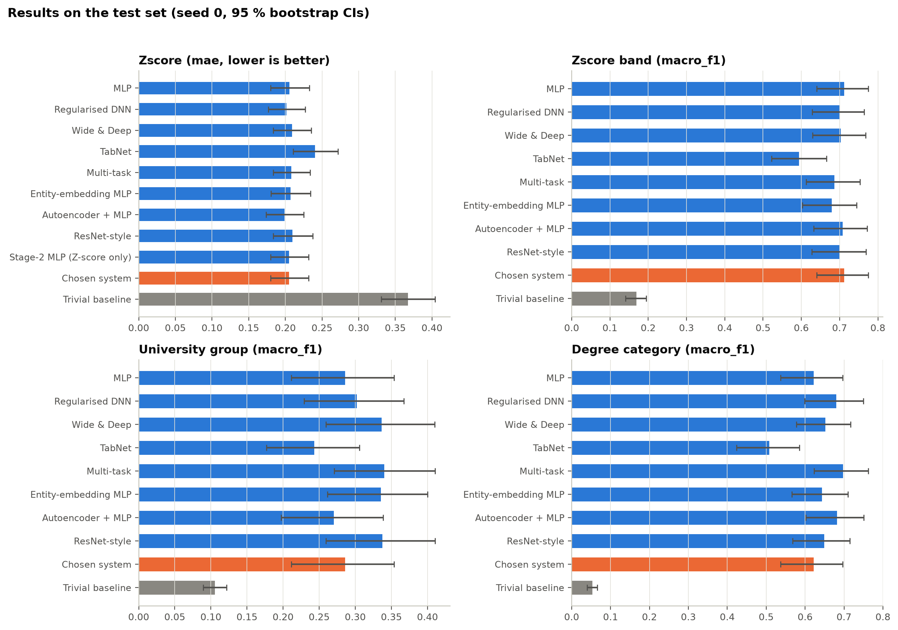
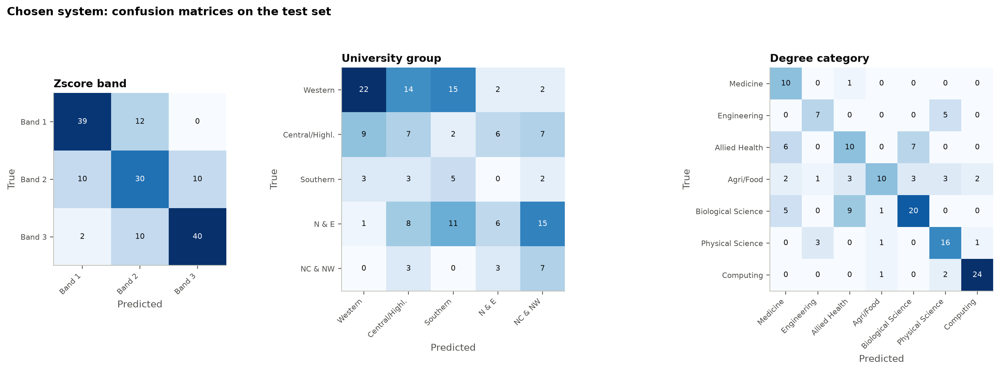
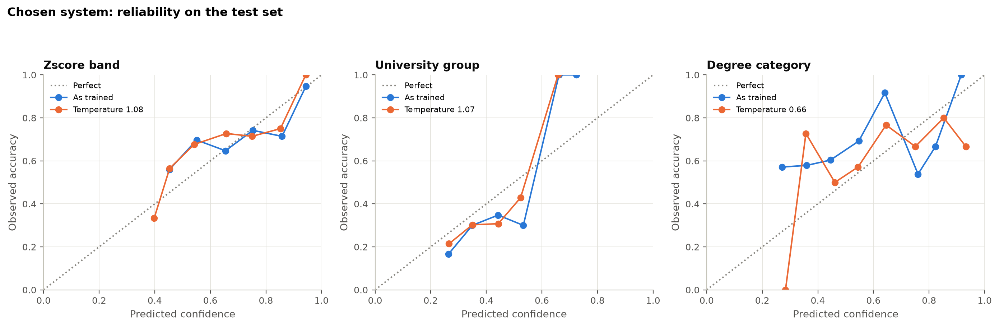

# Phase 7 – Test and Evaluate

| | |
|---|---|
| Date | 15 October 2026 |
| Status | Complete. Waiting for approval to start Phase 8. |
| Code | `src/evaluation/run_phase07.py` (one-time test access), `src/evaluation/phase07_analysis.py` (metrics, CIs, criteria, hypotheses, figures) |
| Results | `reports/phase07/` (one results table per target, success criteria, calibration, comparisons, subgroups, hypotheses, figures) |
| Test access record | `reports/phase07/test_access.json`: opened **once** on 15 October 2026 at 09:41 (Sri Lanka time), 153 rows. The test-ID fingerprint `d5d6cacb…` matches the lock created in Phase 4. |

## 0. Summary in plain words

- **One opening.** The test students (153, never used before) were opened **once**. Every model was scored on them, and nothing was changed afterwards.
- **Better than guessing.** The chosen system is far better than guessing on all four targets. Every result's 95 % confidence range stays clear of the guessing level.
- **Z-score number.** The average error is **0.21 Z-points**, against 0.37 for guessing. The predictions follow the true order well (Spearman 0.80).
- **Z-score band.** **71 %** of students are in the correct band, and **99 %** are in the correct band or the next one.
- **Degree category.** The model is **63 %** right overall (macro F1 0.62). Most of this comes from the A/L subjects the student chose: within one subject group it adds only a little over a simple rule.
- **University group.** This is the weakest target (macro F1 0.29). Within a subject group it does not beat the simple rule "guess the most common university group for those subjects".
- **Confidence percentages.** These are reliable for the Z-score band, but **not for degree category** (it is too unsure of itself), even after the correction from Phase 6.
- **Hypotheses.**

  | Hypothesis | Result |
  |---|---|
  | H1 | Supported |
  | H2 | Supported |
  | H3 | Partly supported |
  | H4 | Supported |
  | H5 (calibration) | **Not supported** |
  | H6 (multi-task effect) | **Not supported** |

- **The chosen model was not the best everywhere.** The locked rule picked the simplest network (MLP). On the test set, three other models were clearly better at degree category: multi-task, autoencoder + MLP and regularised DNN. This is reported as found. The choice was **not** changed after seeing the test results.

## 1. Purpose

This phase scores the chosen models **once** on the locked test set and reports:

- every applicable metric, with a bootstrap confidence interval
- every success criterion fixed in Phase 2, compared with what was measured
- whether each hypothesis is supported
- the negative results

## 2. Procedure

1. **Dry run first (on validation, not test).** The whole analysis was first run on the validation split, written to `reports/phase07_dryrun_validation/`. This found and fixed two code bugs before the test set was touched:
   - a file-key parsing error
   - text columns saved in a format that could not be read back safely

   The dry-run numbers matched Phase 6. For example, the MLP's degree-category calibration error after temperature scaling was 0.115 in both.
2. **One opening.** `python -m src.evaluation.run_phase07` unlocked the test split with the Phase 7 unlock word. It then:
   - transformed the test rows with the **training-fitted** feature pipeline and the frozen band edges
   - ran all **85 saved networks**: 8 models × 5 seeds, the Stage-2 MLP × 5, and the single-task networks × 5 for the negative-transfer check
   - saved the predictions
   - wrote the access record

   A second attempt to open the test set raises `TestAlreadyOpenedError` (unit test).
3. **Analysis of the saved predictions only** (`--analyse`).
   - Every score has a **95 % percentile bootstrap interval from 2,000 resamples**.
   - **The same resamples are used for every model and the baseline**, so all differences are paired (Phase 2 rule).
4. **Which networks are scored.**
   - **Each model is reported with its seed-0 network**, the one that would be deployed.
   - The spread over 5 seeds is reported separately (`seed_spread.csv`).
   - **Predictions are never averaged.**
5. **One fix to the reporting, made after opening the test set.** The subgroup scores first used macro F1 over all 7 degree categories, which counts categories that cannot occur in a subgroup as zero. They were recomputed:
   - over the categories present in the subgroup
   - with a within-subgroup baseline

   This changed only how saved predictions are summarised. No model, threshold or test access changed.

The chosen system (from Phase 6):

| Outputs | Network |
|---|---|
| Z-score band, university group, degree category | Multi-output MLP (1 × 32) |
| Z-score number | Stage-2 single-output MLP (1 × 32) |

## 3. Results tables (test set, seed 0, value [95 % CI])

Full tables with every metric are in `reports/phase07/results_<target>.csv`. Per-class precision and recall and the confusion matrices of every system are in `per_class_and_confusion.json`.

### 3.1 Z-score (regression)

| Model | MAE ↓ | RMSE ↓ | R² | Spearman |
|---|---|---|---|---|
| **Chosen system (Stage-2 MLP)** | **0.205 [0.180, 0.232]** | 0.263 [0.234, 0.293] | 0.633 [0.534, 0.712] | 0.800 [0.723, 0.855] |
| MLP (multi-output) | 0.206 [0.180, 0.233] | 0.266 [0.235, 0.297] | 0.623 [0.523, 0.704] | 0.802 [0.730, 0.856] |
| Regularised DNN | 0.201 [0.177, 0.227] | 0.259 [0.230, 0.290] | 0.642 [0.552, 0.713] | 0.817 [0.744, 0.867] |
| Wide & Deep | 0.209 [0.184, 0.235] | 0.266 [0.235, 0.297] | 0.623 [0.524, 0.703] | 0.799 [0.727, 0.850] |
| TabNet | 0.241 [0.211, 0.272] | 0.309 [0.267, 0.350] | 0.493 [0.340, 0.614] | 0.701 [0.600, 0.784] |
| Multi-task | 0.208 [0.184, 0.234] | 0.266 [0.236, 0.295] | 0.625 [0.522, 0.704] | 0.805 [0.735, 0.857] |
| Entity-embedding MLP | 0.207 [0.180, 0.234] | 0.268 [0.237, 0.301] | 0.617 [0.513, 0.700] | 0.803 [0.729, 0.857] |
| Autoencoder + MLP | 0.199 [0.174, 0.225] | 0.257 [0.226, 0.289] | 0.648 [0.550, 0.725] | 0.813 [0.741, 0.864] |
| ResNet-style | 0.210 [0.183, 0.237] | 0.274 [0.240, 0.309] | 0.601 [0.477, 0.692] | 0.794 [0.716, 0.849] |
| *Trivial baseline (training mean)* | *0.367 [0.331, 0.404]* | *0.434* | *−0.001* | *–* |

### 3.2 Z-score band (ordered, 3 classes)

| Model | Macro F1 | Balanced accuracy | Accuracy | QWK | Within one band | ROC-AUC | Log loss ↓ |
|---|---|---|---|---|---|---|---|
| **Chosen system (MLP)** | **0.712 [0.641, 0.775]** | 0.711 [0.642, 0.777] | 0.712 | 0.755 [0.670, 0.824] | 0.987 [0.967, 1.000] | 0.835 [0.785, 0.882] | 0.737 [0.623, 0.851] |
| Regularised DNN | 0.701 [0.628, 0.764] | 0.704 | 0.706 | 0.758 | 0.987 | 0.862 | 0.680 |
| Wide & Deep | 0.703 [0.630, 0.768] | 0.704 | 0.706 | 0.740 | 0.980 | 0.841 | 0.719 |
| TabNet | 0.594 [0.522, 0.666] | 0.594 | 0.595 | 0.583 | 0.948 | 0.784 | 0.875 |
| Multi-task | 0.686 [0.612, 0.753] | 0.685 | 0.686 | 0.735 | 0.987 | 0.843 | 0.716 |
| Entity-embedding MLP | 0.680 [0.603, 0.745] | 0.679 | 0.680 | 0.716 | 0.980 | 0.844 | 0.728 |
| Autoencoder + MLP | 0.708 [0.632, 0.772] | 0.711 | 0.712 | 0.762 | 0.987 | 0.856 | 0.688 |
| ResNet-style | 0.700 [0.628, 0.769] | 0.704 | 0.706 | 0.745 | 0.980 | 0.836 | 0.743 |
| *Trivial baseline* | *0.169* | *0.333* | *0.340* | *0.000* | *0.667* | *0.500* | *1.099* |

**Per-class recall of the chosen system:**

| Band | Recall |
|---|---|
| Band 1 | 0.76 |
| Band 2 | 0.60 |
| Band 3 | 0.77 |

The middle band is hardest, as is usual for ordered classes. Only **2 of 153** students were placed two bands away from their true band (Figure 7.2).

### 3.3 University group (unordered, 5 classes)

| Model | Macro F1 | Balanced accuracy | Accuracy | ROC-AUC | Log loss ↓ |
|---|---|---|---|---|---|
| **Chosen system (MLP)** | **0.286 [0.212, 0.354]** | 0.339 [0.246, 0.428] | 0.307 | 0.727 [0.679, 0.770] | 1.384 [1.307, 1.464] |
| Regularised DNN | 0.302 [0.229, 0.367] | 0.402 | 0.320 | 0.749 | 1.339 |
| Wide & Deep | 0.337 [0.259, 0.410] | 0.359 | 0.366 | 0.723 | 1.365 |
| TabNet | 0.243 [0.177, 0.306] | 0.300 | 0.275 | 0.695 | 1.418 |
| Multi-task | 0.340 [0.271, 0.410] | 0.383 | 0.379 | 0.741 | 1.334 |
| Entity-embedding MLP | 0.335 [0.261, 0.400] | 0.369 | 0.373 | 0.732 | 1.338 |
| Autoencoder + MLP | 0.270 [0.197, 0.338] | 0.318 | 0.275 | 0.737 | 1.352 |
| ResNet-style | 0.337 [0.259, 0.411] | 0.366 | 0.359 | 0.736 | 1.338 |
| *Trivial baseline* | *0.106* | *0.200* | *0.359* | *0.500* | *1.466* |

**Accuracy is below the trivial baseline.** The chosen system's accuracy (0.31) is lower than always guessing "Western" (0.36). The model was trained with class weights to treat every group fairly (macro F1), which trades raw accuracy for recall on the small groups.

### 3.4 Degree category (unordered, 7 classes)

| Model | Macro F1 | Balanced accuracy | Accuracy | ROC-AUC | Log loss ↓ |
|---|---|---|---|---|---|
| **Chosen system (MLP)** | **0.622 [0.537, 0.696]** | 0.652 [0.575, 0.729] | 0.634 | 0.883 [0.854, 0.911] | 1.194 [1.063, 1.337] |
| Regularised DNN | 0.680 [0.599, 0.750] | 0.715 | 0.686 | 0.915 | 0.911 |
| Wide & Deep | 0.652 [0.578, 0.716] | 0.689 | 0.641 | 0.900 | 1.013 |
| TabNet | 0.508 [0.424, 0.585] | 0.518 | 0.510 | 0.834 | 1.318 |
| Multi-task | **0.698 [0.623, 0.762]** | 0.729 | 0.693 | 0.912 | 0.906 |
| Entity-embedding MLP | 0.643 [0.566, 0.710] | 0.672 | 0.647 | 0.907 | 0.919 |
| Autoencoder + MLP | 0.682 [0.602, 0.751] | 0.721 | 0.686 | 0.918 | 0.858 |
| ResNet-style | 0.649 [0.567, 0.715] | 0.684 | 0.647 | 0.905 | 0.979 |
| *Trivial baseline* | *0.053* | *0.143* | *0.229* | *0.500* | *1.881* |

*Figure 7.1 – Primary metric of every model on the test set, with 95 % bootstrap CIs. Orange = chosen system, grey = trivial baseline.*

*Figure 7.2 – Confusion matrices of the chosen system (rows = true, columns = predicted).*

**What the confusion matrices show:**

- **Degree category:** the errors stay inside the same subject group.
  - Allied Health, Biological Science and Medicine are confused with each other (all Biology students).
  - Engineering and Physical Science are confused with each other (all Combined Maths students).
  - Computing is almost always right (24 of 27).
- **University group:** the errors are spread across all groups.

## 4. Success criteria (locked in Phase 2): chosen system

| Target | Criterion | Value [95 % CI] | Threshold | Verdict |
|---|---|---|---|---|
| Z-score | MAE reduction vs baseline | 0.442 [0.361, 0.515] | ≥ 0.10 | **Met** |
| Z-score | R² CI above 0 | 0.633 [0.534, 0.712] | > 0 | Met |
| Z-score | Spearman CI above 0 | 0.800 [0.723, 0.855] | > 0 | Met |
| Band | Macro F1 gain vs baseline | 0.543 [0.470, 0.615] | ≥ 0.10 | **Met** |
| Band | Balanced accuracy CI above chance | 0.711 [0.642, 0.777] | > 0.333 | Met |
| Band | QWK CI above 0 | 0.755 [0.670, 0.824] | > 0 | Met |
| Band | ROC-AUC CI above 0.5 | 0.835 [0.785, 0.882] | > 0.5 | Met |
| Band | Log loss below baseline | 0.362 [0.247, 0.475] lower | > 0 | Met |
| University group | Macro F1 gain vs baseline | 0.180 [0.101, 0.249] | ≥ 0.10 | **Met** (lower bound only just above) |
| University group | Balanced accuracy CI above chance | 0.339 [0.246, 0.428] | > 0.20 | Met |
| University group | ROC-AUC CI above 0.5 | 0.727 [0.679, 0.770] | > 0.5 | Met |
| University group | Log loss below baseline | 0.082 [−0.026, 0.194] lower | > 0 | **Partly met** (CI crosses 0) |
| Degree category | Macro F1 gain vs baseline | 0.569 [0.480, 0.645] | ≥ 0.10 | **Met** |
| Degree category | Balanced accuracy CI above chance | 0.652 [0.575, 0.729] | > 0.143 | Met |
| Degree category | ROC-AUC CI above 0.5 | 0.883 [0.854, 0.911] | > 0.5 | Met |
| Degree category | Log loss below baseline | 0.686 [0.526, 0.835] lower | > 0 | Met |

**Across all models:**

| Model | Criteria fully met (of 16) | Not fully met |
|---|---|---|
| Regularised DNN, Multi-task, Entity-embedding MLP, ResNet-style | 16 | – |
| MLP, Wide & Deep | 15 | University-group log loss partly met |
| Autoencoder + MLP | 15 | University-group F1 gain partly met (lower bound 0.088) |
| TabNet | 14 | University-group F1 gain and log loss both partly met |

`success_criteria.csv` lists every model.

### 4.1 Calibration (locked: ECE ≤ 0.10, and Brier skill score CI above 0)

| Chosen system | ECE [CI] | ≤ 0.10? | Brier skill score [CI] | CI above 0? |
|---|---|---|---|---|
| Band, as trained | 0.079 [0.054, 0.162] | Yes | 0.347 [0.243, 0.449] | Yes |
| Band, temperature 1.08 | 0.089 [0.055, 0.167] | Yes | 0.347 [0.249, 0.445] | Yes |
| University group, as trained | 0.088 [0.045, 0.160] | Yes | 0.035 [−0.024, 0.092] | **No** |
| University group, temperature 1.07 | 0.078 [0.041, 0.156] | Yes | 0.035 [−0.021, 0.090] | **No** |
| Degree category, as trained | **0.192** [0.123, 0.270] | **No** | 0.309 [0.236, 0.377] | Yes |
| Degree category, temperature 0.66 | **0.108** [0.079, 0.197] | **No** (close) | 0.336 [0.238, 0.429] | Yes |

- **Temperature scaling** (fitted on validation in Phase 6) roughly **halves** the degree-category calibration error, but it stays just above the limit.
- **University-group probabilities** are not measurably more informative than the class frequencies.
- **Other models are not better calibrated overall.** Each one meets the ECE limit for only 1–3 of the three class targets (`calibration.csv`).

*Figure 7.3 – Reliability of the chosen system on test, before (blue) and after (orange) temperature scaling.*

**Consequence for the app (Phase 9).** The confidence message for degree category must use the temperature-scaled probabilities, and must be worded cautiously. University-group probabilities should be shown only as a rough guide.

## 5. Hypotheses (Phase 2)

| ID | Hypothesis (alternative) | Result | Evidence |
|---|---|---|---|
| H1 | Z-score MAE ≥ 10 % below the mean predictor | **Supported** | 44 % lower [36 %, 52 %]; R² and Spearman CIs above 0 |
| H2 | Band macro F1 ≥ baseline + 0.10 | **Supported** | +0.54 [0.47, 0.62]; all 5 minima met |
| H3 | University-group macro F1 ≥ baseline + 0.10 | **Partly supported** | +0.18 [0.10, 0.25] meets the primary criterion. The log-loss minimum is only partly met, and the model does not beat a within-subject-group rule (§6.1). |
| H4 | Degree-category macro F1 ≥ baseline + 0.10 | **Supported** | +0.57 [0.48, 0.65]; all 4 minima met. Most of the gain comes from the A/L subject choice (§6.1). |
| H5 | Selected classifiers calibrated (ECE ≤ 0.10 and Brier skill CI > 0) | **Not supported** | Degree-category ECE 0.19 (0.11 after scaling); university-group Brier skill CI includes 0 |
| H6 | Multi-output and single-task networks differ | **Not supported** (no difference detected on test) | For the MLP and the multi-task network, all 8 task comparisons have CIs including 0. On validation (Phase 6) the MLP showed a small negative transfer for the Z-score; on test the difference is −0.001 [−0.009, 0.008]. |

H7–H12 are answered in later phases: H7 in Phase 8 (feature groups), H8–H12 in Phases 9–11 (gap, recommendations, XAI, chatbot, usability).

## 6. Further checks

### 6.1 Within each A/L subject combination (chosen system)

The **within-group baseline** guesses, for everyone in the group:
- the training mean Z-score of that group, or
- the most common training class of that group.

Macro F1 is computed over the classes present in the group.

| Subject combination (test n) | Z-score MAE (baseline) | Band accuracy (baseline) | University group accuracy (baseline) | Degree accuracy (baseline) |
|---|---|---|---|---|
| Biology + Chemistry + Physics (77) | **0.227** (0.410) | **0.71** (0.38) | 0.30 (**0.35**) | **0.52** (0.46) |
| Chemistry + Physics + Combined Maths (38) | **0.187** (0.335) | **0.71** (0.37) | 0.29 (**0.37**) | **0.61** (0.55) |
| Physics + Combined Maths + ICT (26) | **0.172** (0.267) | **0.69** (0.50) | 0.39 (**0.54**) | 0.92 (**1.00**) |
| Biology + Chemistry + Agri Science (12) | **0.193** (0.264) | **0.75** (0.67) | 0.25 (**0.58**) | 0.83 (**1.00**) |

**What this means:**

- **Z-score and band:** the model adds clear information in every subject group.
- **Degree category:** most of the overall score comes from the subject choice.
  - Within the two large groups, the model is only 6 percentage points better than "guess the group's most common degree".
  - In the two small groups, where every training student entered the same category, the simple rule is already perfect.
- **University group:** within every subject group the model is **less accurate** than "guess the group's most common university group". Partly this is because the class weights trade accuracy for fairness to small classes. But it also means the model has learned little about which university region a student enters beyond the subject choice. This is consistent with university allocation being driven mainly by district quotas (Phase 2, limitation 9).

### 6.2 Fairness check by gender (chosen system; gender is not an input)

| | Female (72) | Male (81) |
|---|---|---|
| Z-score MAE | 0.205 [0.167, 0.245] | 0.205 [0.172, 0.240] |
| Band macro F1 | 0.731 [0.620, 0.830] | 0.689 [0.579, 0.781] |
| University group macro F1 | 0.220 [0.130, 0.314] | 0.340 [0.234, 0.438] |
| Degree category macro F1 | **0.693** [0.570, 0.785] | **0.502** [0.396, 0.634] |

- **Z-score and band** are predicted **equally well** for girls and boys.
- **Degree category is predicted noticeably better for girls.** The intervals overlap only slightly. A possible reason, **not yet checked**, is that the degree categories the model confuses most (Engineering vs Physical Science; Allied Health vs Biological Science) may not be equally common among girls and boys. Phase 8 will check this.
- This is an **association in 153 students**, not proof of bias. It is flagged for the Phase 8 and Phase 9 discussion, and for the thesis.

### 6.3 Comparisons with the chosen system (paired, seed 0)

| Target | Clearly different from the chosen system | Not distinguishable |
|---|---|---|
| Z-score | TabNet worse | All others |
| Band | TabNet worse (−0.12) | All others |
| University group | None (TabNet −0.04, not distinguishable) | All |
| Degree category | **Multi-task better (+0.075 [0.026, 0.132])**, **Autoencoder + MLP better (+0.060)**, **Regularised DNN better (+0.057)**; TabNet worse (−0.11) | Others |

The locked selection rule was based on all four targets together and chose the simplest network. On the test set, **three other networks are clearly better at degree category**. This matches the warning in Phase 6 (§5.5). The choice is **not** changed after seeing the test results, because doing so would break the brief's honesty rules. It is reported as a limitation of the selection rule, and Phase 11 can recommend re-selection for future versions.

### 6.4 Spread over 5 seeds (test, mean ± SD; predictions not averaged)

| Model | Z-score MAE | Band F1 | University group F1 | Degree category F1 |
|---|---|---|---|---|
| MLP (multi-output) | 0.208 ± 0.003 | 0.707 ± 0.014 | 0.326 ± 0.036 | 0.633 ± 0.018 |
| Stage-2 MLP | 0.207 ± 0.002 | – | – | – |
| Regularised DNN | 0.203 ± 0.004 | 0.692 ± 0.019 | 0.296 ± 0.021 | 0.688 ± 0.012 |
| Wide & Deep | 0.210 ± 0.003 | 0.676 ± 0.022 | 0.328 ± 0.018 | 0.654 ± 0.007 |
| TabNet | 0.236 ± 0.005 | 0.631 ± 0.034 | 0.251 ± 0.016 | 0.500 ± 0.104 |
| Multi-task | 0.203 ± 0.004 | 0.689 ± 0.018 | 0.301 ± 0.025 | 0.667 ± 0.018 |
| Entity-embedding MLP | 0.206 ± 0.002 | 0.687 ± 0.018 | 0.327 ± 0.026 | 0.650 ± 0.012 |
| Autoencoder + MLP | 0.202 ± 0.002 | 0.708 ± 0.019 | 0.306 ± 0.027 | 0.687 ± 0.013 |
| ResNet-style | 0.208 ± 0.004 | 0.702 ± 0.017 | 0.324 ± 0.028 | 0.667 ± 0.017 |

The seed-0 test results are typical of each model's 5 seeds. TabNet's degree score swings the most from seed to seed (SD 0.10).

### 6.5 Agreement with validation (Phase 6)

The test scores are close to, and for the Z-score and band slightly better than, the validation scores:

| Chosen system | Validation | Test |
|---|---|---|
| Z-score MAE | 0.209 | 0.205 |
| Band F1 | 0.666 | 0.712 |
| University group F1 | 0.317 | 0.286 |
| Degree category F1 | 0.617 | 0.622 |

There is no sign of over-fitting to the validation split.

## 7. Negative results (reported as required)

1. **TabNet** is the weakest network and is clearly worse than the chosen system on three targets. Its degree-category score is unstable across seeds.
2. **The chosen MLP is clearly beaten on degree category** by three other networks (§6.3).
3. **H5 (calibration) is not supported.** Degree-category probabilities are mis-calibrated even after scaling, and university-group probabilities add almost nothing over the class frequencies.
4. **H6 is not supported on test.** The negative transfer seen on validation for the Z-score does not appear on test.
5. **University group** does not beat a simple subject-based rule within subject groups. Its accuracy (0.31) is below the majority-class guess (0.36).
6. **Degree category** gains little beyond the A/L subject choice.
7. **The gender gap in degree-category performance** (§6.2) needs discussion.

## 8. Tests

**77 unit tests pass**, and ruff reports no problems. The new tests check:

- the met / partly met / not met rule
- the subgroup macro F1 over present classes
- temperature scaling
- that the test set **cannot be opened twice**

## 9. What the next phase needs (Phase 8: interpret results with figures)

- **SHAP explanations** of the chosen system, and **grouped permutation importance** with CIs for hypothesis H7 (feature groups).
- **TabNet mask importance next to SHAP importance.**
- **Partial dependence** for the top features.
- **Polished figures:**
  - model comparison (Figure 7.1)
  - confusion matrices
  - learning curves
  - reliability
  - Z-score residual plot
  - ablation charts
  - embedding plot
- **A plain-language interpretation linked to the hypotheses and the literature**, with "association, not causation" stated throughout.
- **Explanation data:** the explanations will use the training and validation sets plus the saved test predictions. No model is retrained.
