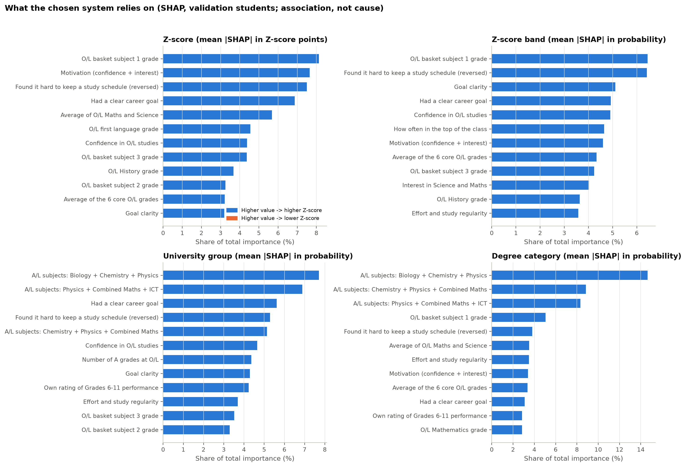
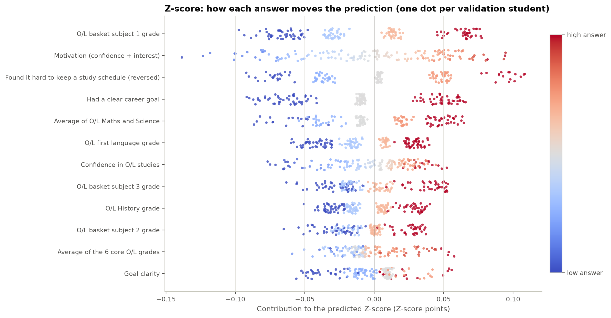
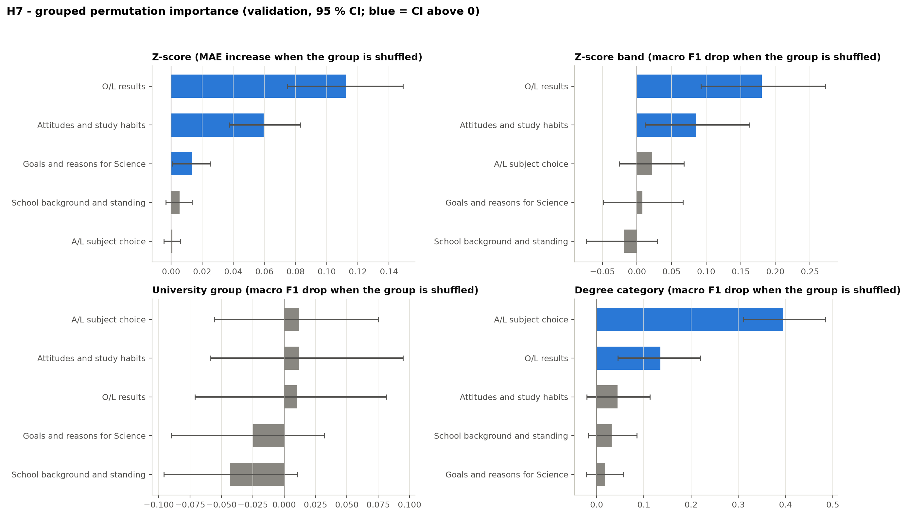
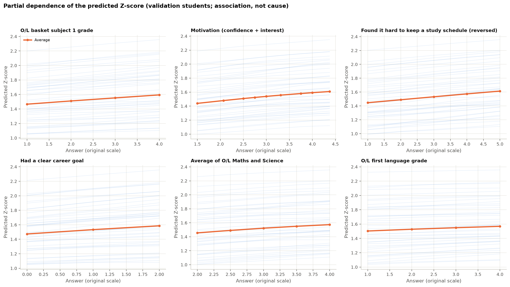
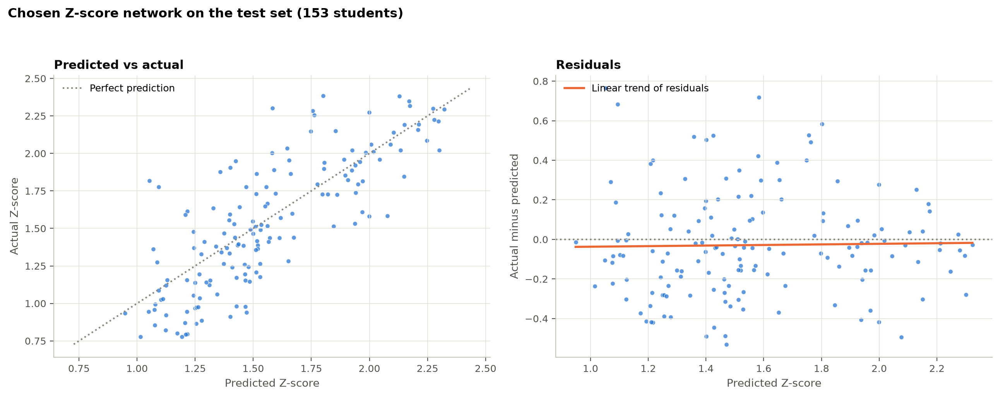
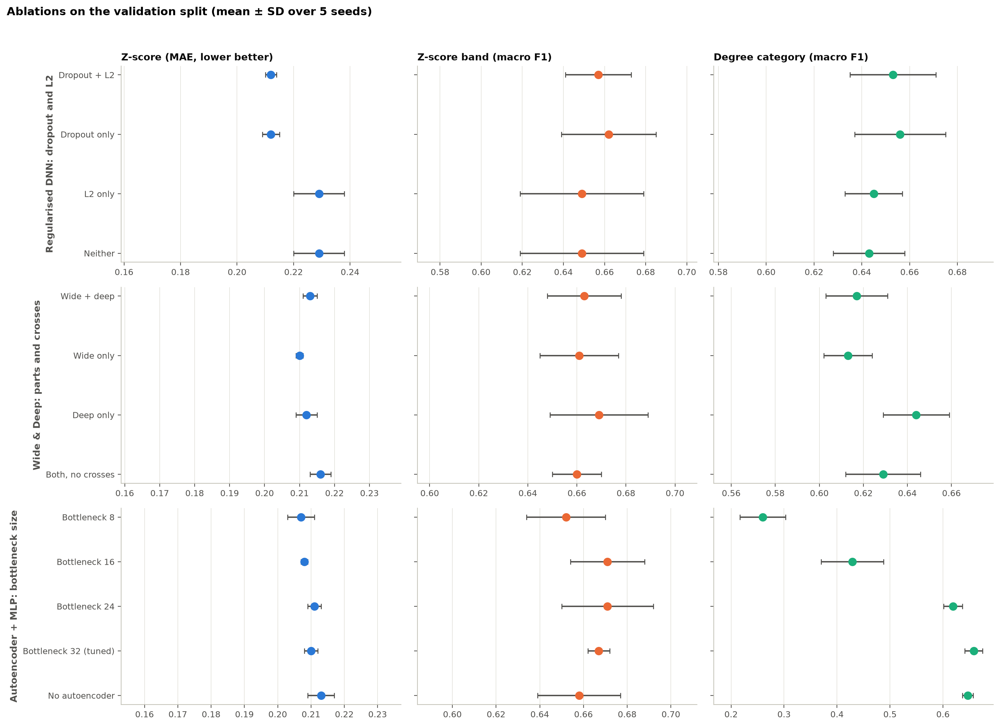
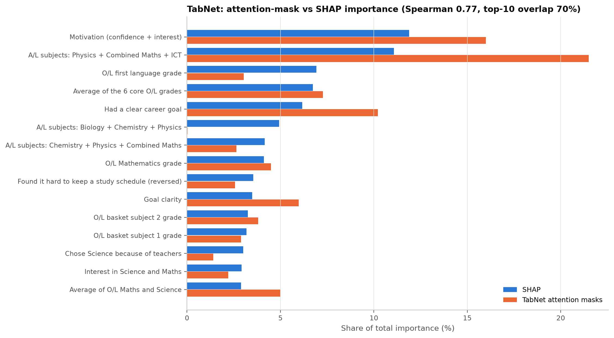

# Phase 8 – Interpret Results with Figures

| | |
|---|---|
| Date | 15 October 2026 |
| Status | Complete. Waiting for approval to start Phase 9. |
| Code | `src/explain/core.py` (reusable XAI part: chosen system, SHAP, grouped permutation importance), `src/explain/run_phase08.py` (`python -m src.explain.run_phase08`) |
| Settings | `configs/explain.yaml` (question groups, plain-language feature names, SHAP and importance settings) |
| Results | `reports/phase08/` (SHAP importance, H7 table, TabNet vs SHAP, partial dependence, gender check, summary) and figures `reports/figures/phase08_*.png` |
| Data used | Explanations: **validation** students (152), with 100 training students as the "typical student" reference. Residual plot and gender check: the test predictions **saved once in Phase 7**. The test set was not read again, and no model was retrained or changed. |

## 0. Summary in plain words

- **What the Z-score predictions mostly follow:**
  1. **O/L results**: basket-subject grades, first language, the Maths and Science average, the number of A grades.
  2. **Attitudes and study habits**: motivation, confidence, keeping to a study schedule.
  3. To a smaller degree, **having a clear career goal**.
  
  All of them point the same way: higher answers go with higher predicted Z-scores.
- **Degree category** is mostly decided by **which A/L subjects** the student chose, then by O/L results.
- **University group:** **no group of questions** helps the model in a measurable way. This confirms Phase 7.
- **School type and class-rank answers** add nothing measurable once the O/L results are known.
- **The explanations can be trusted technically.** Each student's explanation adds up exactly to their prediction. TabNet's own "attention" importance agrees reasonably well with SHAP (rank agreement 0.77).
- **Size of the errors.** For 56 % of test students the predicted Z-score is within ±0.2 of the real one, and for 86 % within ±0.4. There is no systematic over- or under-prediction.
- **Every finding is an association in this sample, not a cause.** The model shows *who tends to* get higher results, not *what would change* a student's result.

## 1. Purpose

This phase:

- explains what drives the predictions, using SHAP, grouped permutation importance and partial dependence
- tests hypothesis H7 (which question groups matter)
- produces the final figures
- links the findings to the hypotheses and the literature

## 2. Methods

| Method | What it shows | Settings |
|---|---|---|
| **SHAP** (Lundberg & Lee, 2017), permutation algorithm | How much each answer moved one student's prediction away from the "typical student" prediction | Background: 100 training students. Explained: 152 validation students. Up to 1,000 evaluations per student. Model-agnostic and exactly additive. |
| **Grouped permutation importance** (H7) | How much the score drops when a whole question group is scrambled | 5 groups (`configs/explain.yaml`). 500 bootstrap draws, each resampling the students and re-scrambling the group. 95 % CI. **H7 is supported for a group if the CI lower bound is above 0.** |
| **Partial dependence** (Friedman, 2001) with individual curves | How the average predicted Z-score changes as one answer changes, with everything else kept as answered | Top 6 Z-score features by SHAP, up to 9 values each. 40 individual students shown as thin lines. |
| **TabNet attention masks vs SHAP** | Whether TabNet's built-in importance agrees with SHAP for the same network | Seed-0 TabNet; importance averaged over the four targets |
| **Residual analysis** | Where and how large the Z-score errors are | Saved test predictions of the chosen Z-score network |

**The question groups (34 inputs).**

| Group | Inputs |
|---|---|
| **O/L results** | 10: seven grades, the core average, the Maths and Science average, the number of A grades |
| **School background and standing** | 8: class rank, own rating of Grades 6–11, school-performance index, five school-type columns |
| **Attitudes and study habits** | 8: er1, er3, er4, self-efficacy, effort regulation, interest, motivation, Grade 11 study hours |
| **Goals and reasons for Science** | 4: career-goal clarity, goal-clarity index, chose Science out of interest, chose Science because of teachers |
| **A/L subject choice** | 4 subject combinations |

School activities and leadership are not among the 34 inputs (the Phase 6 feature-set choice), so they could not be tested here.

## 3. Results

### 3.1 Checks that the explanations are faithful

| Check | Result | Limit (Phase 2, H10) |
|---|---|---|
| Additivity: base value + sum of SHAP values = prediction | Largest error 3 × 10⁻¹⁶ (Z-score 0.0) | ≤ 10⁻⁶ ✓ |
| TabNet attention masks vs SHAP (same network) | Spearman 0.77; 7 of the top-10 features shared | Reported |

The top-5 stability check for repeated runs and the user comprehension test for H10 belong to Phase 9 and Phase 11, where the per-student explanations are built and shown.

### 3.2 What the chosen system relies on (SHAP)

*Figure 8.1 – Share of total SHAP importance of the 12 most important inputs per target (validation students). For the Z-score, every top input has a positive direction: a higher answer goes with a higher prediction.*

**Z-score** (share of total importance; direction = rank correlation between the answer and its SHAP value):

| Input | Share | Direction |
|---|---|---|
| O/L basket subject 1 grade | 8.1 % | + (0.97) |
| Motivation (confidence + interest) | 7.6 % | + (0.99) |
| Kept to a study schedule (er4, reversed) | 7.5 % | + (0.97) |
| Had a clear career goal | 6.9 % | + (0.94) |
| Average of O/L Maths and Science | 5.7 % | + (0.97) |
| O/L first-language grade | 4.6 % | + (0.97) |

**Z-score band:** the same inputs, plus "how often in the top of the class" and goal clarity.

**Degree category:**
- The three A/L subject combinations account for 32 % of the total importance (Biology + Chemistry + Physics alone 15 %).
- O/L grades come next.

**University group:** the importance is spread thinly. The top input (a subject combination) has only 7.7 %, and no input stands out.

**The importance is spread over many inputs.** No single answer dominates the Z-score prediction: the largest share is 8 %. The model combines many small signals.

*Figure 8.2 – Each dot is one validation student. Red means a high answer, blue a low answer. Dots right of zero raised that student's predicted Z-score.*

### 3.3 H7 – which question groups matter (grouped permutation importance)

*Figure 8.3 – Drop in score when a whole group is scrambled (95 % CI). Blue = CI above zero (group matters).*

| Group | Z-score (MAE increase) | Z-score band (F1 drop) | University group (F1 drop) | Degree category (F1 drop) |
|---|---|---|---|---|
| O/L results | **0.112 [0.075, 0.149]** ✓ | **0.181 [0.093, 0.273]** ✓ | 0.010 [−0.071, 0.081] | **0.135 [0.045, 0.219]** ✓ |
| Attitudes and study habits | **0.060 [0.038, 0.083]** ✓ | **0.086 [0.012, 0.163]** ✓ | 0.012 [−0.059, 0.095] | 0.044 [−0.021, 0.113] |
| Goals and reasons for Science | **0.013 [0.001, 0.026]** ✓ | 0.008 [−0.049, 0.066] | −0.025 [−0.090, 0.032] | 0.018 [−0.021, 0.056] |
| School background and standing | 0.006 [−0.003, 0.014] | −0.019 [−0.073, 0.030] | −0.043 [−0.096, 0.011] | 0.032 [−0.017, 0.085] |
| A/L subject choice | 0.001 [−0.005, 0.006] | 0.022 [−0.025, 0.068] | 0.012 [−0.056, 0.075] | **0.394 [0.311, 0.485]** ✓ |

**H7 verdict per group:** for each group H0 says its importance is 0. H0 is rejected where the CI lies above 0 (✓).

- **Supported:**
  - O/L results, for Z-score, band and degree category
  - Attitudes and study habits, for Z-score and band
  - Goals, for the Z-score only (small effect)
  - A/L subject choice, for degree category
- **Not supported:**
  - School background and standing, for any target
  - Any group, for university group

**Overall H7 result: supported for four of the five groups, each for at least one target.**

### 3.4 Partial dependence (Z-score)

*Figure 8.4 – Average predicted Z-score (orange) as one answer changes, with 40 individual students (thin blue lines).*

Moving from the lowest to the highest answer, everything else unchanged, the average predicted Z-score rises by:

| Input | Rise in predicted Z-score |
|---|---|
| Motivation index (1.5 → 4.4) | +0.17 |
| Kept to a study schedule (1 → 5) | +0.17 |
| O/L basket subject 1 grade (S → A) | +0.13 |
| Average of O/L Maths and Science (2 → 4) | +0.12 |
| Clear career goal (No → Yes) | +0.11 |
| O/L first-language grade (S → A) | +0.07 |

- **The curves are almost straight and parallel.** The model has learned mostly additive, nearly linear patterns, and the individual curves barely cross. This fits the Phase 6 finding that very small networks are as good as large ones.
- **These are not effects of changing an answer.** They show how the *prediction* changes in the model, not how a real student's Z-score would change.

### 3.5 Z-score errors (test set, saved Phase 7 predictions)

*Figure 8.5 – Predicted vs actual Z-score, and residuals, for the 153 test students.*

| Measure | Value |
|---|---|
| Residual SD | 0.26 |
| Within ±0.2 of the real Z-score | 56 % |
| Within ±0.4 | 86 % |
| Trend of residuals against the predicted value | slope 0.015 (flat): **no systematic bias** |
| Mean residual, lowest / highest third of *predicted* scores | −0.05 / −0.01 |

**Note on regression to the mean.** Grouped by the *actual* score, the lowest third is over-predicted by 0.23 on average and the highest third under-predicted by 0.15. This is the usual regression to the mean of any imperfect prediction, not a fault of this model. Grouped by the *predicted* score, which is what a student would see, the predictions are unbiased.

**For the app:** a single predicted Z-score is uncertain by roughly ±0.4 for most students. Phase 9 should show a **range**, not one number.

### 3.6 Ablations (validation, from Phase 6)

*Figure 8.6 – Ablation results (mean ± SD over 5 seeds; dots, because the axes are zoomed in).*

- **Regularised DNN:** dropout carries the benefit; L2 changes nothing.
- **Wide & Deep:** neither part, nor the hand-made crosses, is clearly needed.
- **Autoencoder:** compressing below 24 dimensions destroys degree-category information. The Z-score and band survive.

### 3.7 TabNet attention masks next to SHAP

*Figure 8.7 – Share of importance by TabNet's attention masks (orange) and by SHAP (blue), same network.*

**The two broadly agree.** Both put motivation, the ICT subject combination, the core O/L average and the career goal near the top (Spearman 0.77).

**Where they differ:**
- The masks put more weight on the ICT subject combination (21 % vs 11 %).
- The masks give almost no weight to the Biology combination, while SHAP gives it 5 %. TabNet does not need to attend to that column directly, because "not ICT and not Maths" already implies Biology.

Phase 6 found TabNet's mask importance unstable across seeds (mean Spearman 0.18). So even when it agrees with SHAP for one seed, **TabNet's masks are not a reliable explanation tool here.** SHAP will be used for the app.

### 3.8 Earlier figures, for the thesis

| Figure | File |
|---|---|
| Model comparison with CIs (test) | `reports/phase07/comparison.png` |
| Confusion matrices (test) | `reports/phase07/confusion_matrices.png` |
| Reliability before and after scaling (test) | `reports/phase07/reliability.png` |
| Learning curves | `reports/figures/phase06_learning_curves.png` |
| Cross-validation comparison | `reports/figures/phase06_cv_comparison.png` |
| District embedding plot | `reports/figures/phase06_entity_embedding_pca.png` |
| Multi-task loss curves | `reports/figures/phase06_mtl_loss_curves.png` |

All figures use the same colour-blind-safe palette and readable sizes for print. Values are shown as labels or axes, not by colour alone.

### 3.9 The gender gap in degree category (follow-up from Phase 7)

Test students per degree category, and the chosen system's recall:

| Degree category | Female n | Female recall | Male n | Male recall |
|---|---|---|---|---|
| Medicine | 9 | 0.89 | 2 | 1.00 |
| Engineering | 9 | 0.67 | 3 | 0.33 |
| Allied Health Sciences | 12 | 0.50 | 11 | 0.36 |
| Agriculture or Food Science | 11 | 0.55 | 13 | 0.31 |
| Biological Science | 13 | 0.46 | 22 | 0.64 |
| Physical Science | 11 | 0.91 | 10 | 0.60 |
| Computing, IT, AI or Data Science | 7 | 1.00 | 20 | 0.85 |

**Reading the table:**
- **The class mix differs a little by gender.** Boys are more often in Biological Science and Computing, girls more often in Medicine and Engineering.
- **The mix does not explain the gap.** Boys' recall is lower in five of the seven categories, including categories where both genders are well represented: Agriculture or Food Science (0.31 vs 0.55) and Physical Science (0.60 vs 0.91).
- **The groups are very small** (2–22 per cell), so these recalls are imprecise.

**Conclusion:**
- The model predicts degree category less well for boys in this test sample.
- The cause cannot be determined from 153 students.
- Gender is not a model input, so the gap must come through other answers that differ by gender.
- This must be listed as a fairness limitation, and the app must not present degree-category predictions as precise.

## 4. Interpretation

**What the model has learned (association, not causation):**

1. **Prior achievement comes first.**
   - O/L results are the strongest group for the Z-score and the band (H7).
   - This matches the most consistent finding in student-performance research: academic history is the best predictor of later results (Alnasyan et al., 2024, cited in thesis Chapter 2).
   - One detail: in this model, **basket-subject and first-language grades** matter as much as, or more than, the Maths and Science grades.
2. **Motivation and self-regulation add to prior achievement.**
   - Attitudes and study habits are the second group for the Z-score and the band.
   - The largest single contributions are the motivation index (confidence plus interest) and keeping to a study schedule.
   - This fits the MSLQ framework (Pintrich et al., 1991): self-efficacy and effort regulation relate to performance. The question was **not** whether they *cause* higher Z-scores.
3. **Goals matter a little.**
   - Having a clear career goal shows a small but measurable association with the predicted Z-score.
   - This is consistent with goal-setting theory (Locke & Latham, 2002).
4. **School background adds nothing** once O/L results are known. The information in school type, class rank and the student's own rating of past performance is already carried by the grades.
5. **Degree category follows the subject choice.** This is largely by design of the admission system: courses require particular A/L subjects.
6. **University group cannot be explained by these answers.** This is consistent with university placement depending on district quotas and the student's own preference list, neither of which the model sees. Phase 9 will use the official cut-off approach (Option A) instead.

**Links to the hypotheses:**

| Hypothesis | What this phase adds |
|---|---|
| H1–H4 | Phase 7 measured how well the model predicts. This phase shows **why**: mostly prior achievement plus motivation and self-regulation. |
| H7 | Supported for O/L results, attitudes and study habits, goals, and subject choice. Not supported for school background, and not for any group for university group. |
| H10 (explanations faithful and stable) | Faithful: additivity is exact. The stability and comprehension tests follow in Phases 9 and 11. |

**Cautions for the thesis:**

- **Self-report and recall.** All answers were given years later by university students.
- **Data quality.** The Phase 1 observation of unusually uniform attitude answers means that the attitude effects found here should be described cautiously, as possibly dependent on how the data were collected.
- **Selection.** Only students who entered university are in the data (Phase 2 limitation 1).
- **Not advice.** The explanations describe the model, not how a student *should* change. Phase 9 recommendations must say "students with higher X tended to …", never "doing X will raise your Z-score".

## 5. Problems found

1. **No question group helps predict university group** (confirms Phase 7).
2. **Gender gap in degree-category recall**, not explained by the class mix (§3.9).
3. **TabNet masks** agree with SHAP for one seed but are unstable across seeds. They are not used for explanations.
4. **The attitude results depend on data whose distribution was flagged in Phase 1.**
5. **Two figure issues found and fixed in this phase.** The ablation chart originally used bars on a zoomed axis (changed to dots). The residual summary was first grouped by actual score (regression to the mean); the predicted-score grouping was added.

## 6. Tests

**81 unit tests pass**, and ruff reports no problems. The new tests check:

- plain-language names
- that every input belongs to exactly one question group
- that SHAP values add up exactly to the prediction
- that grouped permutation importance finds a used group and ignores an unused one

## 7. What the next phase needs (Phase 9: build the five system parts)

1. **Chatbot language model and API key.** The brief says to ask. The thesis draft used a local Llama 3.2 (3B) through Ollama, which is free and keeps data on the computer. Do you want the same, or a different model or API?
2. **Official cut-offs (Option A for university guidance).** Extract the cut-off tables from the three UGC PDFs (2019/20, 2021/22, 2023/24). Then compare the predicted Z-score **range** with the cut-offs for the student's target course and district.
3. **Prediction display.**
   - Show a range for the Z-score (about ±0.4 for most students), not a single number.
   - Show calibrated band probabilities.
   - For degree category, use temperature-scaled probabilities and cautious wording.
   - For university group, show only the top 2 as a rough guide.
4. **Per-student explanations.** Use SHAP from `src/explain/core.py`, phrased as "students with … tended to …", and add the top-5 stability check (H10).
5. **Recommendations.** Use the A/L study-habit questions (past papers, revision, study hours) only as evidence about what successful students reported. **Never as a cause.**
